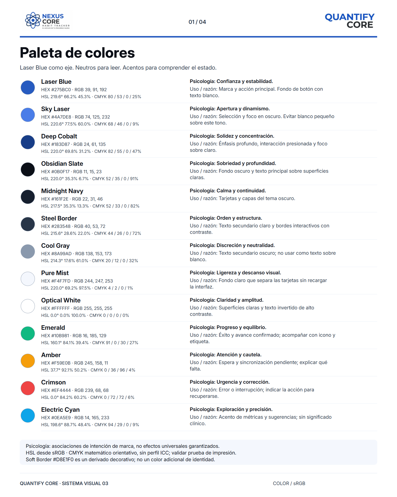
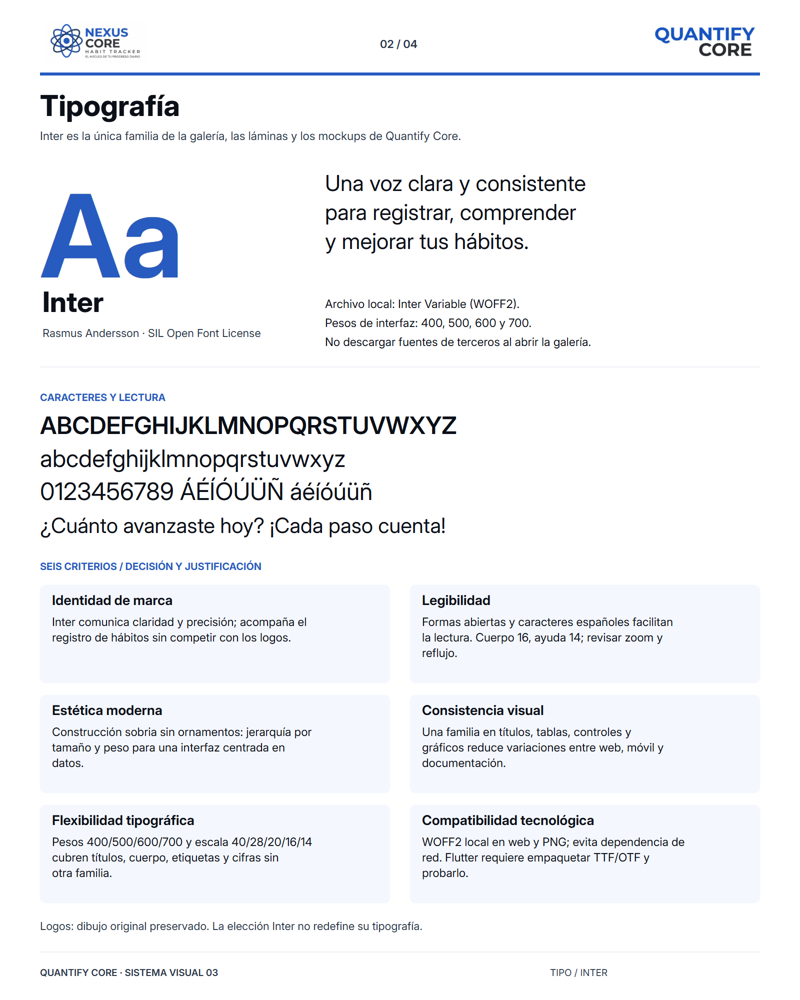
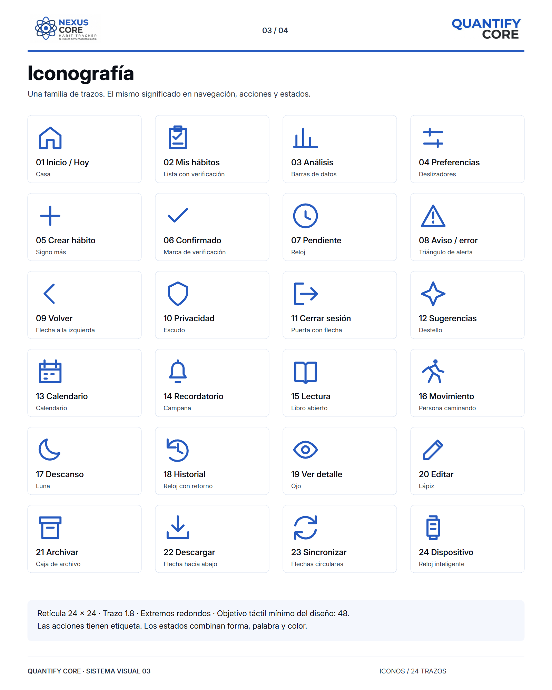
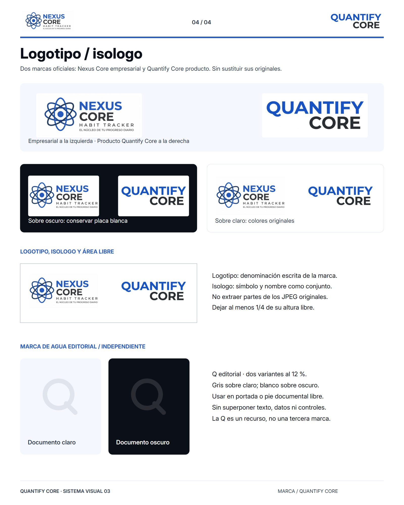
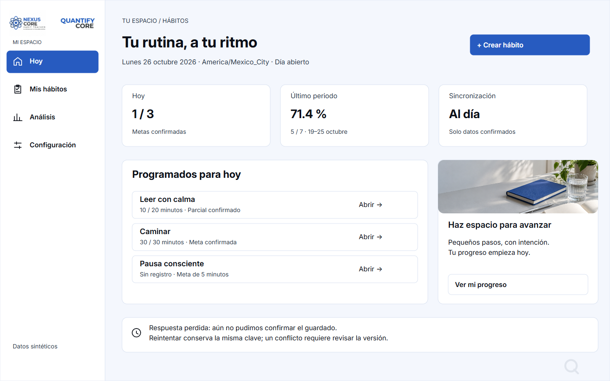

# Quantify Core · Galería y sistema visual

**Versión 03 · 28 de octubre de 2026 · [QUANCORE-26](https://utxicotepec-team-q5ufett6.atlassian.net/browse/QUANCORE-26)**

## Contenido

1. [Revisar las imágenes](#revisar-las-imágenes)
2. [Sistema visual](#1-paleta-de-colores)
3. [Prototipos](#prototipos-tres-fidelidades-reales)
4. [Organización y mantenimiento](#organización-y-mantenimiento)
5. [Publicación y control de ramas](#publicación-y-control-de-ramas)
6. [Verificación y límites](#verificación-y-límites)

## Estado de la entrega

| Elemento | Estado | Dónde revisarlo |
|---|---|---|
| Paleta, tipografía, iconografía, logotipo/isologo y marcas de agua | Cuatro lienzos PNG en hotfix | [imagenes/](imagenes/) |
| Pantallas en sketch, wireframe y mockup | Completo (34 PNG) | [prototipos/](prototipos/) |
| Galería pública | Versión anterior; esta hotfix no se publica en Pages | [Abrir galería](https://angeljesus13.github.io/Quantify-Core/docs/GUI/) |
| Archivo editable | Conexión autenticada; Figma rechaza acceso al archivo | [Figma](https://www.figma.com/design/iLvbL5uaWxAPwuX58xN4yq/Quantify-Core-%C2%B7-Sistema-visual-y-prototipos--QUANCORE-26-?node-id=0-1&t=vNJ6E9RRwxvSXkNs-1) |
| Implementación en producto | Pendiente | Ver [Verificación y límites](#verificación-y-límites) |

## Revisar las imágenes

### [Abrir la galería en GitHub Pages →](https://angeljesus13.github.io/Quantify-Core/docs/GUI/)

**Estado de esta revisión:** cuatro lienzos en la rama `hotfix/QUANCORE-26-cuatro-lienzos`; GitHub Pages conserva la versión anterior. [Abrir la galería local](index.html). Cada lienzo puede ampliarse y descargarse; los prototipos conservan sus filtros y visor.

Figma está instalado y autenticado. Los intentos de sesión y lectura del nodo `0:1` del 28/10/2026 devolvieron falta de acceso de edición. No fue posible auditar ni modificar el archivo remoto. El propietario debe compartirlo como editor; no se afirma sincronización con esta revisión.

Esta es la **única documentación completa de la entrega visual**. Los índices de `docs/diseno` y del mapa documental enlazan aquí. Se retiraron las tablas de enlaces SVG, el manual duplicado, los manifiestos duplicados, los informes separados y los iconos exportados uno por uno. Las fuentes de autoría permanecen para poder actualizar las imágenes sin redibujar cada una manualmente.

## 1. Paleta de colores

[](imagenes/01-paleta-de-colores.png)

La identidad conserva **Laser Blue `#275BC0`** como marca y acción principal. La imagen desarrolla las trece familias de la [paleta canónica](../../packages/design-tokens/README.md), con valores HEX/RGB/HSL/CMYK, psicología y justificación por color: marca, neutros y estados. HSL se deriva de sRGB; CMYK usa conversión matemática sin perfil ICC y requiere prueba de impresión. La separación de roles sostiene jerarquía y legibilidad; no se atribuyen efectos psicológicos universales al color.

Tema claro: fondo Pure Mist, tarjetas blancas, texto Obsidian y secundario Steel. Tema oscuro: fondo Obsidian, tarjetas Midnight, texto blanco y secundario Cool Gray. El borde suave derivado `#D8E1F0` separa tarjetas decorativas; no sirve como único contorno de un control interactivo. Campos y controles de wireframe usan borde con contraste. En la implementación, distinguir el borde decorativo del borde requerido para identificar un control.

Blanco sobre Laser Blue alcanza **6.28:1**; Cool Gray sobre Midnight **5.70:1**. Cool Gray sobre blanco y blanco sobre Sky Laser no se usan para texto pequeño. Emerald, Amber, Crimson y Cyan son acentos acompañados de palabras y formas. Un dato pendiente no se comunica como confirmado por su color.

La fuente de valores y geometría es [preview.json](../../packages/design-tokens/preview.json). El nombre histórico del archivo no implica que Inter siga sin elegir: la familia de esta entrega queda definida por la solicitud del proyecto. Todavía no se distribuye un paquete de componentes React/Flutter.

## 2. Tipografía definida: Inter

[](imagenes/02-tipografia.png)

**Inter es la familia para títulos, párrafos, formularios, botones, etiquetas, gráficos y galería.** Los logos oficiales conservan su dibujo original. Se incluye el mismo archivo [Inter Variable WOFF2](assets/inter.woff2) y se renderizan los PNG con él. No se mezclan Segoe UI y Arial ni se depende de Google Fonts al abrir la página. `sans-serif` queda únicamente como recuperación de emergencia si el archivo no puede cargarse, no como otra elección de diseño.

Inter ofrece una construcción legible para interfaz, soporte de los caracteres del español y pesos variables sin cambiar de familia. Escala base: 40 presentación, 28 pantalla, 20 sección, 16 cuerpo y 14 ayuda; pesos habituales 400/500/600/700. El logotipo raster heredado conserva su dibujo original: no se pretende identificar o sustituir la fuente con la que fue creado.

Los seis criterios del lienzo se justifican así:

| Criterio | Justificación de Inter |
|---|---|
| Identidad de marca | Claridad y precisión para registrar hábitos; acompaña las marcas oficiales. |
| Legibilidad | Formas abiertas y español; cuerpo 16 y ayuda 14, con revisión de zoom y reflujo al implementar. |
| Estética moderna | Dibujo sobrio y jerarquía por tamaño/peso para una interfaz de datos. |
| Consistencia visual | Una familia compartida en títulos, controles, tablas y gráficos. |
| Flexibilidad tipográfica | Pesos 400/500/600/700 y escala 40/28/20/16/14 sin añadir otra familia. |
| Compatibilidad tecnológica | WOFF2 local verificado en navegador y exportación; Flutter necesita TTF/OTF empaquetado y validación propia. |

Fuente: [proyecto oficial rsms/inter](https://github.com/rsms/inter), autoría Rasmus Andersson; [licencia SIL Open Font License incluida](assets/inter-license.txt). Archivo fijado al commit `353b61b9f4430d5f420d56605a6e7993e0941470`, sin modificaciones. SHA-256 WOFF2: `693b77d4f32ee9b8bfc995589b5fad5e99adf2832738661f5402f9978429a8e3`.

## 3. Iconografía en una sola lámina

[](imagenes/03-iconografia.png)

Cada icono identifica su función y el símbolo que lo representa (casa, escudo, reloj, etc.). La imagen reúne los **24 iconos**: Hoy, hábitos, análisis, preferencias, crear, confirmado, pendiente, aviso, volver, privacidad, salir, sugerencias, calendario, recordatorio, lectura, movimiento, descanso, historial, ver, editar, archivar, descargar, sincronizar y dispositivo.

Todos comparten retícula 24 × 24, trazo 1.8, extremos/uniones redondos y ausencia de relleno. Se dibujan desde un catálogo único en [la fuente](fuente/generar.py), utilizado también por los mockups. No se instala otra familia ni se mezclan emojis como iconos de navegación. Las acciones conservan etiqueta; los estados combinan forma y texto. Objetivo de interacción del diseño: 48 unidades, por resolver y comprobar al implementar cada plataforma.

Los trazos son originales de esta entrega y siguen las condiciones de distribución del repositorio; no se les atribuye una licencia externa inexistente. Para controles de producto, un icono decorativo se oculta al lector y un control sin texto necesita nombre accesible.

### Uso de imágenes (reglas documentales, sin quinto lienzo)

La fotografía representa un ritual cotidiano de lectura e hidratación: luz natural, objetos sencillos, paleta neutra y cuaderno azul. Se usa en bienvenida, apoyo del dashboard y cabecera de la galería. Los formularios priorizan la tarea; no se añade una foto a cada tarjeta por decoración.

El encuadre conserva proporciones mediante recorte de ventana, sin deformar la imagen; deja espacio útil y evita superponer texto sobre zonas de poco contraste. Una imagen informativa lleva descripción contextual; la decorativa no repite lo que ya dice el texto. Las gráficas conservan alternativa textual, periodo y unidad. No se usan fotos de personas, capturas de datos privados ni imágenes de marcas ajenas.

[ritual-cotidiano.png](assets/ritual-cotidiano.png) fue creado para esta entrega mediante generación de imágenes de OpenAI el 26/10/2026. Es una imagen editorial sintética, no evidencia de un usuario ni de mediciones de salud. Las fotografías del ejemplo aportado por el usuario solo inspiran la organización del manual; no se copian Spotify, sus recursos ni sus fuentes.

## 4. Logotipo / isologo y marcas de agua

[](imagenes/04-identidad-isologo.png)

Las cabeceras presentan **Nexus Core (empresarial) a la izquierda** y **Quantify Core (producto) a la derecha**. Se utilizan los JPEG originales, con su color y proporciones. Sobre oscuro permanecen en una placa blanca. La lámina explica su convivencia sin convertirlos en una sola marca ni recolorear sus letras.

El símbolo Q parecido a una lupa, utilizado en la primera revisión, es únicamente una **marca de agua editorial de la documentación visual**. Es independiente de ambas marcas oficiales y no las sustituye ni representa una tercera identidad empresarial. Aparece de forma tenue como sello de la maqueta; no funciona como botón, icono de búsqueda o logotipo del producto. Los wireframes mantienen referencias de marca en grises; los sketches continúan sin texto ni logos.

Logotipo designa la denominación escrita; isologo, el conjunto de símbolo y nombre. Los JPEG se presentan íntegros sin inventar una versión separable. Área libre propuesta: al menos un cuarto de la altura visible de cada firma; comprobar legibilidad al reducirla. Marca de agua editorial Q: dos variantes al 12 % (gris sobre claro y blanco sobre oscuro), en portada o pie libre de texto y controles, independiente de los logos oficiales. La afinidad geométrica y los neutros mantienen coherencia sin confundir empresa, producto y documentación.

No estirar, recortar letras, añadir sombras ni invertir automáticamente los JPEG. Se pueden retirar visualmente márgenes blancos exteriores para presentar el contenido, conservando todas las letras y símbolos. La tipografía Inter rige los textos de la interfaz; las marcas raster conservan su dibujo propio.

Los archivos [quantifyLogo.jpeg](../../assets/images/quantifyLogo.jpeg), [productLogo.jpeg](../../assets/images/productLogo.jpeg) y [enterpriseLogo.jpeg](../../assets/images/enterpriseLogo.jpeg) permanecen intactos. La autoría/licencia del material heredado conserva el estado del [inventario original](../../assets/images/README.md). No se reemplazan activos de prácticas ni de `main`.

## Prototipos: tres fidelidades reales

**Sketches:** trazos irregulares y formas para explorar composición. **No contienen letras ni texto visible**, ni marca, fotografía, cifras o contenido de pantalla. Los nombres y las referencias se muestran en la galería, fuera de la imagen.

**Wireframes:** estructura en grises con bloques, campos y etiquetas funcionales. Permiten evaluar jerarquía, navegación y distribución sin fotografía ni identidad gráfica.

**Mockups:** diseños estáticos con Inter, logos oficiales empresarial/producto, colores claros/oscuros, iconos y fotografías donde aportan contexto. Son guía visual de interfaz; los botones dibujados no ejecutan acciones de negocio.

Hay **34 PNG de pantallas**: ocho sketches, ocho wireframes, dieciséis mockups claros/oscuros y dos variantes de Hoy en escritorio. Los móviles usan lienzo 390 × 844; administración y Hoy de escritorio, 1440 × 900. La galería es adaptable; una imagen estática no demuestra reflujo ni texto grande dentro de una aplicación futura.

[](prototipos/mockups/hoy-escritorio-light.png)

### Cobertura funcional y trazabilidad

- **Acceso:** RF-01, referencia U01–U05/U15. Continuar con Keycloak, cancelar a bienvenida y resolver sesión vencida. Sin contraseña local ni autenticación paralela.
- **Hoy:** RF-03/04, U06. Hábitos programados y valor confirmado por día; vacío ofrece crear hábito. Los pendientes se separan de los confirmados.
- **Crear hábito:** RF-03, U07. Nombre, meta, unidad, días y zona; validación conserva borrador. Cancelar creación vuelve a Hoy; cancelar edición vuelve al detalle.
- **Registrar avance:** RF-04, U08/U13. Valor acumulado absoluto por fecha de negocio. Reintentar conserva la clave idempotente; un conflicto requiere revisar la versión. Archivar conserva el historial.
- **Análisis:** RF-05, U10. Ventana cerrada, unidad, zona, fuente, regla y alternativa textual. Sin oportunidades se muestra «sin datos», no fracaso.
- **Sugerencias:** RF-07, U11. Abstención explicada cuando faltan datos o consentimiento. Personalizar no acepta hasta guardar; cancelar no consume la recomendación.
- **Preferencias:** RF-02, U12. Finalidad voluntaria por uso y fuente; guardar explícitamente. Revocar bloquea usos futuros. Cambiar zona no reclasifica el historial.
- **Administración:** RF-09/10, A02/A03/A06. Agregados autorizados, motivo y auditoría; sin acceso a rutinas privadas por el simple rol de administrador.

Estados a implementar por recorrido: carga, vacío, validación, error de servicio, sesión vencida, permiso insuficiente y conflicto. Pendiente de sincronización es una variante condicionada a soporte offline aprobado; hasta entonces guardar exige conexión. El catálogo de estados sigue en las [reglas canónicas](../requerimientos/reglas-negocio.md), [recorridos](../diseno/recorridos.md) y [sistema de diseño](../diseno/sistema-diseno.md), no en fichas universales que sustituyan una pantalla real.

Análisis usa datos sintéticos del 19–25/10/2026: un hábito diario, completas L=1, M=1, X=0, J=1, V=1, S=1, D=0. Cumplimiento 5/7 = 71.4 %, racha al cierre 0 **en ese periodo**, zona America/Mexico_City, regla RN-P17, cálculo ilustrativo 26/10. El 26/10 es día abierto y aparece separado en Hoy. No se inventan biometría ni puntuaciones de IA.

La cobertura no equivale a las 24 pantallas históricas completas. Recordatorios/avisos, vinculación Wear OS, exportación/eliminación personal y formularios administrativos detallados requieren ampliación. RF-01 a RF-05 enlazan el [contrato propuesto](../../packages/contracts/README.md); RF-06 a RF-10 requieren contratos adicionales. Las láminas no añaden endpoints ni certifican backend, permisos o sincronización.

## Organización y mantenimiento

```text
docs/GUI/
  README.md             Documentación completa de esta entrega
  index.html            Galería pública y visor
  imagenes/             Los cuatro lienzos completos (PNG)
  prototipos/           Sketches, wireframes y mockups (PNG)
  assets/               Fuente Inter, licencia, foto, estilos e interacción
  fuente/               Dos archivos para regenerar las imágenes
```

Cada PNG corresponde a una lámina o variante de pantalla; no se mantiene una segunda copia SVG exportada ni 24 iconos sueltos. La fuente vectorial vive en el generador y sus temporales quedan ignorados en `.build/`. Los PNG preservan exactamente la tipografía elegida al revisarlos en otro equipo.

Para consultar localmente con la fuente web exacta, servir la raíz con `python -m http.server 8765`, y visitar `http://localhost:8765/docs/GUI/`. No hace falta instalar dependencias para consultar la galería. Para regenerar: Python 3 ejecuta `python docs/GUI/fuente/generar.py`; el entorno de autoría con Node/Playwright y Chrome ejecuta `node docs/GUI/fuente/render.cjs`. El exportador comprueba carga de Inter y texto dentro de los lienzos. Los paths del navegador se pueden configurar mediante `QC_CHROME`; Playwright debe estar disponible en el entorno. No se instala como dependencia del producto.

Los cambios visuales compartidos se hacen primero en tokens o en el catálogo de la fuente, se regeneran las imágenes y se revisan ambos temas. React y Flutter deberán incorporar la misma familia y semántica al implementar componentes; esta entrega no modifica clientes de producto todavía inexistentes en esta base.

## Publicación y control de ramas

Base: `origin/develop`, commit `dc127ea`, obtenido el 28/10/2026. La copia anterior conserva su `develop` divergente (`ba7bc96`, un commit local y cinco remotos distintos); se creó una copia independiente para conservar ese historial sin reset, rebase ni merge. En la nueva copia, `develop` coincide con remoto y la hotfix parte de él.

Por instrucción expresa del usuario, `hotfix/QUANCORE-26-cuatro-lienzos` parte de `develop`, excepción al origen `main` del flujo general. La rama permanece abierta. No se modifica `main`, no se fusiona ni se publica en `gh-pages`. La Práctica 07 y los logos originales quedan fuera del cambio.

## Verificación y límites

La revisión de esta hotfix valida generación de los cuatro lienzos, Inter, límites de texto, galería local y enlaces. Las comprobaciones del 26/10 descritas abajo son evidencia histórica y no acreditan publicación de esta versión.

No se declara conformidad WCAG global. La galería utiliza controles HTML con nombre y foco visible; los PNG no son controles accesibles de aplicación. La implementación deberá probar lector de pantalla, teclado, zoom, reflujo y tamaños táctiles de cada componente. No se comprobaron clientes nativos, autenticación, API o hardware real mediante estas imágenes.

Para verificar integridad desde la raíz:

```sh
node --check docs/GUI/assets/galeria.js
node --test --test-timeout=10000 docs/practica-07/tests/prototipo.test.cjs
git diff --check
git diff 55604085492983ecebcea81d0ad4d0fef04d99a9 -- docs/practica-07
git rev-parse HEAD:docs/practica-07
```

El diff de Práctica 07 debe estar vacío y su árbol coincidir con el indicado.

### Resultados de la hotfix (28/10/2026)

- Cuatro PNG de identidad a 1600 × 2000; Inter cargada y texto dentro del lienzo.
- Galería local: 320, 390, 768 y 1440 px; 16 revisiones del visor (cuatro lienzos por ancho), ampliación, flechas, Escape, retorno del foco y enlace de descarga. Sin desbordamiento horizontal, imágenes rotas ni errores de página o HTTP.
- Documentación: 72 Markdown, 515 enlaces locales y 51 bloques Mermaid válidos; OpenAPI válido.
- Práctica 07: 21/21 pruebas existentes; sin cambios en su árbol ni en los logos o los 34 prototipos.
- Figma: acceso rechazado; sin lectura ni cambios remotos. GitHub Pages conserva la versión anterior.

### Evidencia histórica de la versión 02 (26/10/2026)

- **39 imágenes exportadas:** cinco láminas de identidad a 1600 × 2000 y 34 pantallas. Se comprobó la fuente Inter antes de exportar y las cajas de texto dentro del lienzo. Los ocho sketches no contienen elementos de texto visible.
- **16 configuraciones del visor**, entre fidelidades/temas a 320, 390, 768 y 1440 px, con 208 cargas de miniaturas comprobadas. Las vistas de escritorio se revisaron también a esos cuatro anchos. Sin desbordamiento horizontal de página ni errores JavaScript o peticiones fallidas por HTTP local.
- **Visor:** las cinco láminas abren a resolución original; se comprobaron descarga PNG, ampliación, flechas, Escape y restauración de foco.
- **Tipografía:** Inter local cargada y familia calculada coherente en títulos, párrafos, controles y enlaces de la galería. Los logos oficiales son imágenes independientes de la fuente de interfaz.
- **Documentación:** `node scripts/check-docs.mjs` aprobó 72 Markdown, 514 enlaces locales y 51 bloques Mermaid, además de la comprobación básica OpenAPI existente. La revisión específica de los seis documentos/entrada afectados comprobó 126 enlaces locales sin destinos rotos.
- **Práctica 07:** 21/21 pruebas existentes aprobadas; diff vacío y árbol conservado. Los tres logos heredados mantienen sus bytes originales.
- **Publicación:** GitHub informó despliegue `built` desde `gh-pages`. La revisión pública repitió las 16 configuraciones y las 208 cargas de miniaturas sin errores. Se comprobaron HTTP 200 y coincidencia SHA-256 de 42 recursos: 39 imágenes, Inter y los dos logos oficiales. El portal principal y los cuatro recursos principales de Práctica 07 coinciden byte por byte con sus blobs Git; los 13 archivos de la práctica conservan el árbol original. No se creó PR ni se hizo merge.

La galería se verificó tanto por HTTP local como en el sitio público de GitHub Pages el 26/10/2026. Esta revisión de imágenes y controles del visor no certifica accesibilidad global ni implementación funcional de una aplicación de producto.
