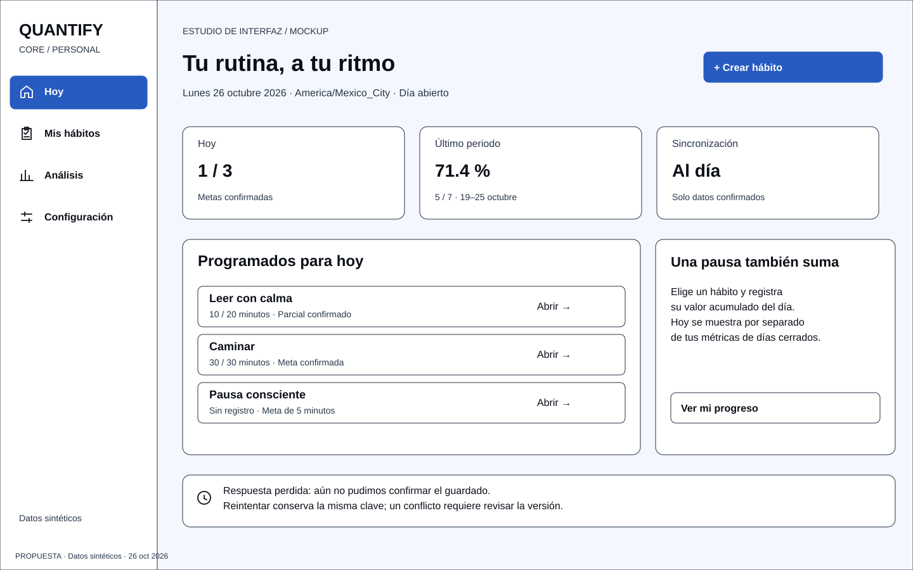
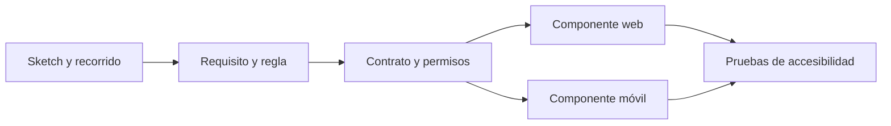

# GUI · Interfaz gráfica

## Estudio visual V2.0 · QUANCORE-26

[Abrir galería de revisión](index.html) · [Matriz de pantallas y estados](matriz-pantallas.md) · [Manual visual](../diseno/manual-visual.html) · [Validación](VALIDACION.md).

Esta entrega propone ocho vistas en tres niveles: sketches conceptuales, wireframes en grises y mockups claros/oscuros. Incluye Hoy en móvil y escritorio; administración en escritorio. Son 34 láminas SVG exportables, con datos sintéticos y anotaciones de requisitos. La galería permite comparar niveles, temas y recorridos; los botones dibujados no ejecutan operaciones de producto.

### Organización de los entregables

| Ubicación | Contenido |
|---|---|
| `sketches/` | Ocho redibujos conceptuales con referencia a IDs de la demo |
| `wireframes/` | Ocho composiciones estructurales en grises |
| `mockups/` | Dieciséis vistas claras/oscuras y dos variantes de Hoy en escritorio |
| [pantallas.json](pantallas.json) | Inventario, requisitos, referencia histórica y variantes |
| [generar-prototipos.py](generar-prototipos.py) | Fuente reproducible de las láminas y recursos visuales |
| [preview.json](../../packages/design-tokens/preview.json) | Tokens propuestos solo para revisión; paleta existente |

Abrir `index.html` directamente en un navegador o servir la raíz del repositorio con `python -m http.server 8765` y visitar `http://localhost:8765/docs/GUI/`. No requiere instalación de dependencias. Para regenerar, ejecutar `python docs/GUI/generar-prototipos.py` desde la raíz, con Python 3. La galería usa solo archivos locales, sin fuentes de red ni almacenamiento de usuario.

La Práctica 07 sigue intacta y separada; sus screenshots y reglas históricas no se trasladan como identidad o autorización de producto. Estas nuevas láminas materializan propuestas, no cierran las decisiones de D-10 ni acreditan implementación React/Flutter.

Esta carpeta reúne la referencia para las pantallas y estados visuales de Quantify Core. **Estado:** existe un [prototipo académico navegable](../practica-07/README.md); los clientes React y Flutter del producto todavía no están implementados. El [sistema de diseño V2.0](../diseno/sistema-diseno.md) y los [tokens](../../packages/design-tokens/README.md) son la referencia de producto.

## Recorridos que debe explicar la GUI

| Recorrido | Referencia visual | Estados y límites |
|---|---|---|
| Acceso y perfil | U01 a U05, U12 del [prototipo](../practica-07/README.md) | Cargando, sesión vencida, validación, consentimiento y acceso propio. |
| Hábitos y progreso | U06 a U08, U13 | Vacío, edición, pendiente, confirmado, conflicto, pausa y archivo. |
| Métricas y sugerencias | U10, U11 | Sin datos, cálculo pendiente, resultado explicable y abstención. |
| Avisos y configuración | U09, U14, U15 | Permiso denegado, horario/zona, desactivación y cierre de sesión. |
| Administración | A01 a A09 | Permisos específicos, confirmación con motivo y datos agregados. |

Los IDs de pantalla pertenecen a la demo; los [recorridos V2.0](../diseno/recorridos.md) describen qué se mantiene, adapta o requiere contrato. La navegación de revisión del prototipo permite abrir pantallas sin sesión; eso no es autorización para el producto.

## Reglas de implementación visual

- Conservar el mismo significado de estados y acciones en web y móvil; adaptar la distribución, no crear fórmulas distintas por cliente.
- La pantalla no decide permisos por ocultar botones. La API comprueba identidad, rol y pertenencia.
- Mostrar «pendiente de sincronización» hasta que llegue confirmación. Un conflicto requiere revisión del usuario; no se resuelve por el reloj del dispositivo.
- Cada gráfico incluye texto, unidad, periodo, fuente y estado «sin datos» cuando corresponda. Color solo es apoyo.
- Comprobar teclado, foco, lectura accesible, contraste y temas. La [paleta del sketch](../practica-07/README.md) no sustituye los tokens V2.0.

Para revisar visualmente, abrir el [prototipo](https://angeljesus13.github.io/Quantify-Core/docs/practica-07/) y el [mapa de navegación](https://angeljesus13.github.io/Quantify-Core/docs/practica-07/navegacion.html). Sus capturas y estados son evidencia de diseño académico. Los nuevos componentes deberán enlazar RF, historia, tokens, contrato y prueba de accesibilidad.
