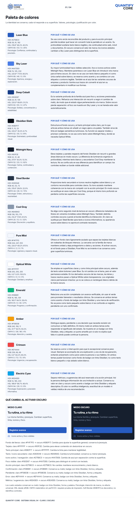
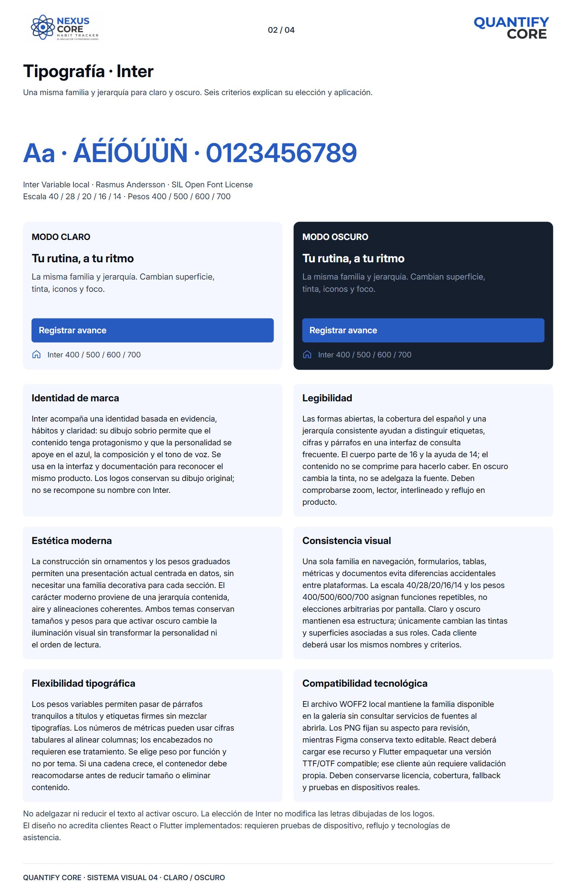
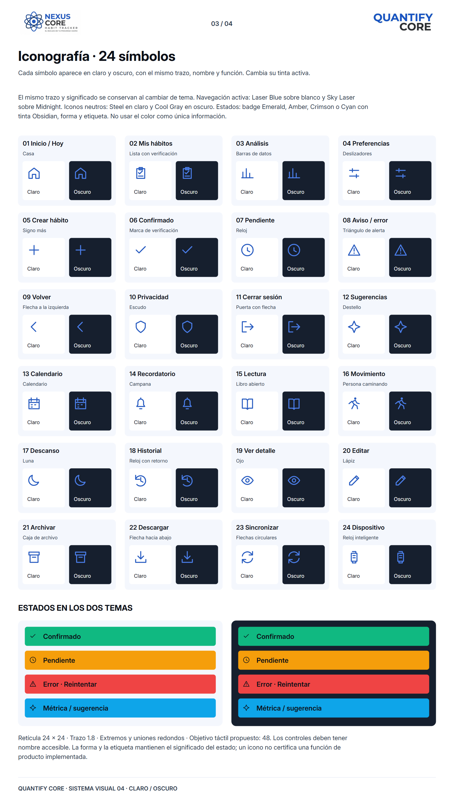
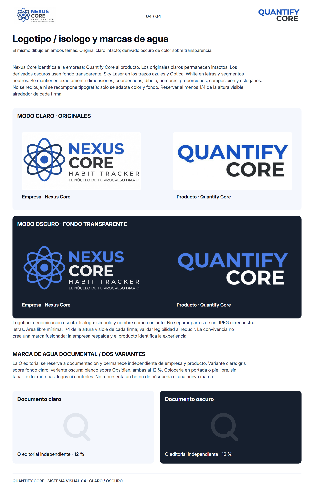

# Identidad visual de Quantify Core

Este único README reúne **paleta de colores, tipografía, iconografía, logotipo del producto, firma empresarial y marcas de agua**, con sus justificaciones y cuatro lienzos. Se documentan claro y oscuro sin cambiar la identidad canónica. Cada tema es un apartado de este mismo documento.

[Índice GUI](../README.md) · [Galería](../index.html#identidad) · [Móvil](../prototipos/movil/README.md)

- [Paleta y justificaciones](#paleta-de-colores)
- [Tipografía y seis criterios](#tipografía)
- [Iconografía](#iconografía)
- [Marcas oficiales](#marcas-oficiales)
- [Marcas de agua](#marcas-de-agua)
- [Estado de Figma](#estado-del-archivo-figma)

## Paleta de colores

[](imagenes/01-paleta-de-colores.png)

La identidad conserva **Laser Blue `#275BC0`** como marca y acción principal. La imagen desarrolla las trece familias de la [paleta canónica](../../../packages/design-tokens/README.md), con valores HEX/RGB/HSL/CMYK, psicología y justificación por color: marca, neutros y estados. HSL se deriva de sRGB; CMYK usa conversión matemática sin perfil ICC y requiere prueba de impresión. La separación de roles sostiene jerarquía y legibilidad; no se atribuyen efectos psicológicos universales al color.

Tema claro: fondo Pure Mist, tarjetas blancas, texto Obsidian y secundario Steel. Tema oscuro: fondo Obsidian, tarjetas Midnight, texto blanco y secundario Cool Gray. El borde suave derivado `#D8E1F0` separa tarjetas decorativas; no sirve como único contorno de un control interactivo. Campos y controles de wireframe usan borde con contraste. En la implementación, distinguir el borde decorativo del borde requerido para identificar un control.

Blanco sobre Laser Blue alcanza **6.28:1**; Cool Gray sobre Midnight **5.70:1**. Cool Gray sobre blanco y blanco sobre Sky Laser no se usan para texto pequeño. Emerald, Amber, Crimson y Cyan son acentos acompañados de palabras y formas. Un dato pendiente no se comunica como confirmado por su color.

La fuente de valores y geometría es [preview.json](../../../packages/design-tokens/preview.json). El nombre histórico del archivo no implica que Inter siga sin elegir: la familia de esta entrega queda definida por la solicitud del proyecto. Todavía no se distribuye un paquete de componentes React/Flutter.

### Justificación completa por color

**Laser Blue.** Psicología de marca: Confianza, continuidad y precisión. Se usa como ancla reconocible del producto y para la acción principal: permite localizar qué hacer sin convertir toda la pantalla en un acento. Su profundidad sostiene texto blanco legible y da continuidad entre web, móvil y documentos. En oscuro conserva el valor de marca; los iconos aislados cambian a Sky Laser para distinguirse de la superficie.

**Sky Laser.** Psicología de marca: Apertura, energía y exploración. Su mayor luminosidad hace visibles selección, foco e iconos activos sobre Midnight Navy. Mantiene parentesco con Laser Blue sin introducir otra marca para el tema oscuro. En claro no se usa con texto blanco pequeño ni como única señal sobre blanco; se reserva como acento y se combina con una etiqueta o contorno legible. También es el azul de las variantes oscuras de empresa y producto: ilumina sus trazos sin convertir el azul en su complementario ni modificar sus formas.

**Deep Cobalt.** Psicología de marca: Solidez, concentración y estabilidad. Es la variante profunda de la familia azul para foco y acciones presionadas sobre claro. Refuerza una interacción sin recurrir a negro ni cambiar de matiz, de modo que el estado sigue perteneciendo a la marca. Sobre oscuro pierde separación: el foco se muestra en Sky Laser y no se hereda este valor automáticamente.

**Obsidian Slate.** Psicología de marca: Sobriedad y profundidad visual. Estructura el fondo oscuro y el texto principal sobre claro, por lo que articula ambos temas sin añadir un negro ajeno a la paleta. También sirve de tinta en badges semánticos luminosos. Su función es separar niveles y priorizar contenido; no se usa como texto sobre Midnight Navy, donde se necesita Optical White.

**Midnight Navy.** Psicología de marca: Calma, continuidad y contención. Eleva tarjetas y paneles respecto del fondo Obsidian sin recurrir a grandes áreas blancas en modo oscuro. La diferencia de luminancia organiza la profundidad, mientras texto blanco y secundarios Cool Gray mantienen la lectura. No se confía solo en esa diferencia para identificar un campo: los controles reciben un borde visible adicional.

**Steel Border.** Psicología de marca: Orden, estructura y neutralidad. Proporciona texto secundario e iconos neutros legibles sobre blanco y un contorno reconocible para controles claros. Su tono azulado mantiene coherencia con la marca sin competir con la acción principal. En modo oscuro se sustituye en esos roles por Cool Gray, porque el mismo tono profundo se perdería contra las superficies oscuras.

**Cool Gray.** Psicología de marca: Discreción y equilibrio. Se elige como segundo nivel de lectura en oscuro: diferencia metadatos de títulos sin volverlos invisibles sobre Midnight Navy. También delimita controles oscuros cuando el borde identifica la interacción. En claro se sustituye por Steel Border para texto e iconos informativos; su apariencia suave sobre blanco no aporta el contraste necesario.

**Pure Mist.** Psicología de marca: Ligereza y espacio visual. Ofrece un fondo claro ligeramente azulado que separa las tarjetas blancas sin rodearlas de bloques intensos. La cercanía con la familia de marca mantiene unidad y deja protagonismo a datos y acciones. Al activar oscuro, el rol fondo pasa a Obsidian; Pure Mist no se invierte ni se conserva como gran superficie luminosa.

**Optical White.** Psicología de marca: Claridad y amplitud. Se emplea en superficies claras y como tinta principal sobre oscuro, además de texto sobre botones Laser Blue. Su rol cambia con el tema, pero el valor permanece estable. En los derivados oscuros de las marcas, las letras y trazos neutros pasan a Optical White sobre transparencia. Los originales claros permanecen intactos: ya no se coloca un rectángulo blanco detrás de la marca oscura.

**Emerald.** Psicología de marca: Progreso y confirmación. Relaciona una acción completada con avance verificable, sin usar el verde para prometer bienestar o resultados clínicos. Se conserva en ambos temas como acento o fondo de badge con tinta Obsidian y una marca de verificación. No se pone como texto pequeño sobre blanco ni se confunde un registro pendiente con uno confirmado.

**Amber.** Psicología de marca: Atención y cautela. Distingue espera, pendiente o una decisión que necesita revisión sin comunicar un fallo definitivo. El mismo matiz en ambos temas evita reaprender el significado del estado. Se muestra en un badge con tinta Obsidian, reloj y etiqueta: un punto amarillo por sí solo no explica qué falta ni cuándo puede continuar la persona.

**Crimson.** Psicología de marca: Urgencia y recuperación. Se reserva a error o interrupción para que lo excepcional conserve peso visual. Siempre se acompaña de una explicación y una vía de recuperación, evitando presentarlo como juicio sobre la persona o sus hábitos. En ambos temas puede funcionar como fondo de badge con tinta Obsidian; no como texto blanco pequeño o rojo aislado sobre blanco.

**Electric Cyan.** Psicología de marca: Exploración y precisión informativa. Separa métricas y sugerencias del azul reservado a la acción principal. Así la persona distingue información de una invitación a actuar. Conserva su valor en claro y oscuro como acento o badge con tinta Obsidian y etiqueta descriptiva. El color no certifica inteligencia, exactitud de un modelo ni validez médica de una recomendación.

### Aplicación de claro y oscuro

Los valores primitivos no se invierten: cambian sus asignaciones por rol. [preview.json](../../../packages/design-tokens/preview.json) es la fuente; [themes.css](../../../packages/design-tokens/themes.css) exporta los roles para revisión y futuros consumidores. El tema normal es claro; `data-qc-theme="dark"` selecciona oscuro en un consumidor que use esas variables. La galería conserva su diseño editorial claro y muestra los dos temas dentro de cada lienzo; no se declara implementado un selector de tema del producto.

| Rol | Claro | Oscuro | Criterio |
|---|---|---|---|
| Fondo del lienzo | `#F4F7FD` | `#0B0F17` | Cambia para ajustar la superficie general; conserva la jerarquía. |
| Tarjeta | `#FFFFFF` | `#161F2E` | Cambia para elevar contenido sin deslumbrar en oscuro. |
| Texto principal | `#0B0F17` | `#FFFFFF` | Cambia la tinta para mantener legibilidad. |
| Texto / icono secundario | `#283548` | `#8A99AD` | Cambia la luminosidad; conserva su menor jerarquía. |
| Icono activo / navegación | `#275BC0` | `#4A7DE8` | Cambia de azul por separación contra la superficie. |
| Foco visible | `#183D87` | `#4A7DE8` | Cambia para distinguir el control con teclado. |
| Acción principal | `#275BC0` | `#275BC0` | No cambia: mantiene reconocimiento y texto blanco. |
| Confirmación | `#10B981` | `#10B981` | Conserva su matiz; badge con tinta Obsidian, forma y etiqueta. |
| Pendiente | `#F59E0B` | `#F59E0B` | Conserva su matiz; badge con tinta Obsidian, forma y etiqueta. |
| Error | `#EF4444` | `#EF4444` | Conserva su matiz; badge con tinta Obsidian, forma y etiqueta. |
| Métrica / sugerencia | `#0EA5E9` | `#0EA5E9` | Conserva su matiz; badge con tinta Obsidian, forma y etiqueta. |

Los badges semánticos usan tinta Obsidian sobre Emerald, Amber, Crimson y Cyan en ambos temas. No trasladar esos tonos a texto pequeño sobre blanco. Las etiquetas, formas y explicación conservan el significado aunque no se distinga el color.

## Tipografía

[](imagenes/02-tipografia.png)

**Inter es la familia para títulos, párrafos, formularios, botones, etiquetas, gráficos de la interfaz final y la galería.** Los logos oficiales conservan su dibujo original. Se incluye el mismo archivo [Inter Variable WOFF2](../assets/inter.woff2) y se renderizan los mockups con él, sin depender de Google Fonts. Los wireframes son la excepción metodológica: usan Arial genérica, sin representar la tipografía final. Los sketches no tienen texto. `sans-serif` en la galería queda únicamente como recuperación si Inter no puede cargarse.

Inter ofrece una construcción legible para interfaz, soporte de los caracteres del español y pesos variables sin cambiar de familia. Escala base: 40 presentación, 28 pantalla, 20 sección, 16 cuerpo y 14 ayuda; pesos habituales 400/500/600/700. El logotipo raster heredado conserva su dibujo original: no se pretende identificar o sustituir la fuente con la que fue creado.

Los seis criterios del lienzo se desarrollan así:

**Identidad de marca.** Inter acompaña una identidad basada en evidencia, hábitos y claridad: su dibujo sobrio permite que el contenido tenga protagonismo y que la personalidad se apoye en el azul, la composición y el tono de voz. Se usa en la interfaz y documentación para reconocer el mismo producto. Los logos conservan su dibujo original; no se recompone su nombre con Inter.

**Legibilidad.** Las formas abiertas, la cobertura del español y una jerarquía consistente ayudan a distinguir etiquetas, cifras y párrafos en una interfaz de consulta frecuente. El cuerpo parte de 16 y la ayuda de 14; el contenido no se comprime para hacerlo caber. En oscuro cambia la tinta, no se adelgaza la fuente. Deben comprobarse zoom, lector, interlineado y reflujo en producto.

**Estética moderna.** La construcción sin ornamentos y los pesos graduados permiten una presentación actual centrada en datos, sin necesitar una familia decorativa para cada sección. El carácter moderno proviene de una jerarquía contenida, aire y alineaciones coherentes. Ambos temas conservan tamaños y pesos para que activar oscuro cambie la iluminación visual sin transformar la personalidad ni el orden de lectura.

**Consistencia visual.** Una sola familia en navegación, formularios, tablas, métricas y documentos evita diferencias accidentales entre plataformas. La escala 40/28/20/16/14 y los pesos 400/500/600/700 asignan funciones repetibles, no elecciones arbitrarias por pantalla. Claro y oscuro mantienen esa estructura; únicamente cambian las tintas y superficies asociadas a sus roles. Cada cliente deberá usar los mismos nombres y criterios.

**Flexibilidad tipográfica.** Los pesos variables permiten pasar de párrafos tranquilos a títulos y etiquetas firmes sin mezclar tipografías. Los números de métricas pueden usar cifras tabulares al alinear columnas; los encabezados no requieren ese tratamiento. Se elige peso por función y no por tema. Si una cadena crece, el contenedor debe reacomodarse antes de reducir tamaño o eliminar contenido.

**Compatibilidad tecnológica.** El archivo WOFF2 local mantiene la familia disponible en la galería sin consultar servicios de fuentes al abrirla. Los PNG fijan su aspecto para revisión, mientras Figma conserva texto editable. React deberá cargar ese recurso y Flutter empaquetar una versión TTF/OTF compatible; ese cliente aún requiere validación propia. Deben conservarse licencia, cobertura, fallback y pruebas en dispositivos reales.

Fuente: [proyecto oficial rsms/inter](https://github.com/rsms/inter), autoría Rasmus Andersson; [licencia SIL Open Font License incluida](../assets/inter-license.txt). Archivo fijado al commit `353b61b9f4430d5f420d56605a6e7993e0941470`, sin modificaciones. SHA-256 WOFF2: `693b77d4f32ee9b8bfc995589b5fad5e99adf2832738661f5402f9978429a8e3`.

## Iconografía

[](imagenes/03-iconografia.png)

Cada icono identifica su función y el símbolo que lo representa (casa, escudo, reloj, etc.), con muestras en claro y oscuro. El mismo trazo y significado se conservan al cambiar de tema. Navegación activa: Laser Blue sobre blanco y Sky Laser sobre Midnight. Iconos neutros: Steel en claro y Cool Gray en oscuro. Estados: badge Emerald, Amber, Crimson o Cyan con tinta Obsidian, forma y etiqueta. No usar el color como única información. La imagen reúne los **24 iconos**: Hoy, hábitos, análisis, preferencias, crear, confirmado, pendiente, aviso, volver, privacidad, salir, sugerencias, calendario, recordatorio, lectura, movimiento, descanso, historial, ver, editar, archivar, descargar, sincronizar y dispositivo.

Todos comparten retícula 24 × 24, trazo 1.8, extremos/uniones redondos y ausencia de relleno. Se dibujan desde un catálogo único en [la fuente](../fuente/generar.py), utilizado también por los mockups. No se instala otra familia ni se mezclan emojis como iconos de navegación. Las acciones conservan etiqueta; los estados combinan forma y texto. Objetivo de interacción del diseño: 48 unidades, por resolver y comprobar al implementar cada plataforma.

Los trazos son originales de esta entrega y siguen las condiciones de distribución del repositorio; no se les atribuye una licencia externa inexistente. Para controles de producto, un icono decorativo se oculta al lector y un control sin texto necesita nombre accesible.

### Uso de imágenes (reglas documentales, sin quinto lienzo)

La fotografía representa un ritual cotidiano de lectura e hidratación: luz natural, objetos sencillos, paleta neutra y cuaderno azul. Se usa en bienvenida, apoyo del dashboard y cabecera de la galería. Los formularios priorizan la tarea; no se añade una foto a cada tarjeta por decoración.

El encuadre conserva proporciones mediante recorte de ventana, sin deformar la imagen; deja espacio útil y evita superponer texto sobre zonas de poco contraste. Una imagen informativa lleva descripción contextual; la decorativa no repite lo que ya dice el texto. Las gráficas conservan alternativa textual, periodo y unidad. No se usan fotos de personas, capturas de datos privados ni imágenes de marcas ajenas.

[ritual-cotidiano.png](../assets/ritual-cotidiano.png) fue creado para esta entrega mediante generación de imágenes de OpenAI el 26/10/2026. Es una imagen editorial sintética, no evidencia de un usuario ni de mediciones de salud. Las fotografías del ejemplo aportado por el usuario solo inspiran la organización del manual; no se copian Spotify, sus recursos ni sus fuentes.

## Marcas oficiales

Quantify Core utiliza un **logotipo** tipográfico. La firma empresarial Nexus Core combina símbolo y nombre en la composición existente. Se documenta íntegra; no se crea un isotipo separado ni otra versión de marca.

[](imagenes/04-identidad-isologo.png)

Las cabeceras presentan **Nexus Core (empresarial) a la izquierda** y **Quantify Core (producto) a la derecha**. En claro se utilizan los JPEG originales sin cambios. En oscuro se utilizan sus derivados PNG transparentes, con Sky Laser y Optical White, sin placa blanca. Las dos marcas conservan sus formas y proporciones; no se fusionan ni se redibujan.

En Quantify Core, logotipo designa la denominación escrita. Nexus Core reúne símbolo y nombre en una firma combinada (imagotipo); un isologo los fusionaría en una unidad inseparable. El símbolo aislado sería un isotipo, pero no se crea ni se publica uno nuevo: los JPEG existentes se presentan íntegros. El nombre histórico del PNG no determina esta clasificación. Área libre propuesta: al menos un cuarto de la altura visible de cada firma; comprobar legibilidad al reducirla. La afinidad geométrica y los neutros mantienen coherencia sin confundir empresa, producto y documentación.

No estirar, recortar letras, añadir sombras ni invertir automáticamente los JPEG. La adaptación de color/fondo autorizada el 29/10/2026 se aplica a archivos derivados y no sobrescribe originales. Se pueden retirar visualmente márgenes blancos exteriores para presentar el contenido, conservando todas las letras y símbolos. La tipografía Inter rige los textos de la interfaz; las marcas raster conservan su dibujo propio.

Los archivos [quantifyLogo.jpeg](../../../assets/images/quantifyLogo.jpeg), [productLogo.jpeg](../../../assets/images/productLogo.jpeg) y [enterpriseLogo.jpeg](../../../assets/images/enterpriseLogo.jpeg) permanecen intactos. La autoría/licencia del material heredado conserva el estado del [inventario original](../../../assets/images/README.md). Se actualizan únicamente las referencias o aplicaciones afectadas de esos mismos logos; no se modifican prácticas funcionales ni `main`.

### Variantes claras y oscuras

Se mantienen los originales claros byte por byte y se generan [empresa oscura](../../../assets/images/brand/enterprise-dark.png) y [producto oscuro](../../../assets/images/brand/product-dark.png) con transparencia. [Manifiesto de procedencia](../../../assets/images/brand/variants.json) · [Generador reproducible](../fuente/marcas.py).

Se reutilizan **Sky Laser `#4A7DE8`** y **Optical White `#FFFFFF`**; no se añade un color nuevo. Sky Laser tiene contraste 4.25:1 sobre Midnight y 4.92:1 sobre Obsidian; se aplica a las marcas, no se autoriza como texto pequeño general. Los eslóganes y letras neutras se muestran en blanco. La medida de contraste se refiere al color sólido: los bordes suavizados de un raster tienen cobertura parcial.

La derivación mantiene los 1600 × 1194 píxeles y sus coordenadas; no recorta, escala, vectoriza, dilata trazos ni escribe letras nuevas. Extrae cobertura de tinta del mate casi blanco y reasigna colores. Se conservan símbolos, nombres, composición y eslóganes. El generador registra hashes de los originales y derivados y usa roles de [preview.json](../../../packages/design-tokens/preview.json).

Las aplicaciones oscuras actualizadas son los veinte mockups móviles, las dos referencias de escritorio que ya contenían estos logos, la lámina de marcas y la explicación de paleta, y las referencias HTML/Markdown a los mismos originales. La geometría y el resto de píxeles de los mockups móviles permanecen iguales fuera de la cabecera. Sketches, wireframes y mockups claros no se regeneran. No se añaden pantallas PWA.

Para regenerar los únicos PNG afectados:

```powershell
python docs/GUI/fuente/generar.py --brand-only
node docs/GUI/fuente/render.cjs
```

El generador de variantes usa Pillow en el entorno de autoría, como los recursos gráficos; no es una dependencia de producto. Esta corrección conserva los cuatro lienzos de identidad y los veinte conjuntos móviles.

## Marcas de agua

La Q editorial, parecida a una lupa, se reserva a documentación y no sustituye al logotipo del producto ni a la firma empresarial. No es un botón de búsqueda ni una tercera identidad. Se aplica al 12 %: gris sobre claro y blanco sobre Obsidian, en portada o pie libre de texto, métricas, logos y controles. Su geometría y los neutros mantienen afinidad visual con el sistema. Los wireframes solo usan referencias de marca en grises y los sketches no llevan logos.

## Estado del archivo Figma

Edición pausada por el usuario. Los cuatro lienzos existentes corresponden a paleta, tipografía, iconografía y marcas; los PNG locales comparten contenido y roles, pero no se presentan como exportaciones idénticas de Figma. Las dos imágenes oscuras del lienzo de marcas (`17:528` y `17:531`) se reemplazaron. Retirar los fondos blancos de sus contenedores y ajustar sus textos sigue pendiente de revisión manual; la operación oficial fue rechazada por el límite Starter. No se han hecho nuevas lecturas ni ediciones tras la pausa. El enlace del archivo editable está en el [índice de GUI](../README.md).

## Fuentes y mantenimiento

Los valores canónicos están en [tokens](../../../packages/design-tokens/preview.json); las justificaciones y geometría, en [identidad.json](../fuente/identidad.json) y [generar.py](../fuente/generar.py). Cambiar estas fuentes, regenerar y revisar ambos temas; no editar cada PNG por separado. La interfaz propuesta para React/Flutter aún necesita implementación.

Para regenerar los cuatro lienzos, desde la raíz del repositorio:

```powershell
python docs/GUI/fuente/generar.py
$env:QC_IDENTITY_ONLY='1'
node docs/GUI/fuente/render.cjs
```

El entorno de autoría necesita Python/Pillow, Node/Playwright y Chrome (`QC_CHROME` permite configurar su ruta). El exportador comprueba Inter y límites de texto. Los lienzos conservan 1600 px de ancho y adaptan su altura al contenido. Los temporales quedan en `.build/`; no hay una segunda colección SVG ni iconos PNG sueltos.

Verificación del 29/10/2026: originales claros íntegros, generación determinista y alfa transparente comprobados; los ocho tests de identidad/móvil pasaron. Los 24 PNG afectados por las variantes oscuras se renderizaron con medición de texto. Esto valida la documentación visual, no una biblioteca de componentes ni conformidad WCAG global.
