# Móvil · Sketches

20 PNG. Solo cuadros y líneas en blanco/gris; sin texto, logos, fotos, color ni temas. El número y el nombre se identifican fuera del dibujo. Miniaturas de 210 px, hasta tres por fila; pulsa una imagen para abrir el PNG completo a 390 × 844. Son documentación estática.

[Índice y matriz móvil](../README.md) · [Condiciones por pantalla](../README.md#condiciones-por-pantalla) · [Identidad visual](../../../identidad/README.md) · [Galería](../../../index.html#prototipos)

- [Inicio y acceso · 01–02](#inicio-y-acceso)
- [Hábitos y registros · 03–09](#hábitos-y-registros)
- [Recordatorios y avisos · 10–11](#recordatorios-y-avisos)
- [Análisis y sugerencias · 12–15](#análisis-y-sugerencias)
- [Perfil, privacidad y dispositivos · 16–20](#perfil-privacidad-y-dispositivos)

## Inicio y acceso

| **01 Bienvenida** `bienvenida` | **02 Acceso** `acceso` | — |
|---|---|---|
| <a href="bienvenida.png">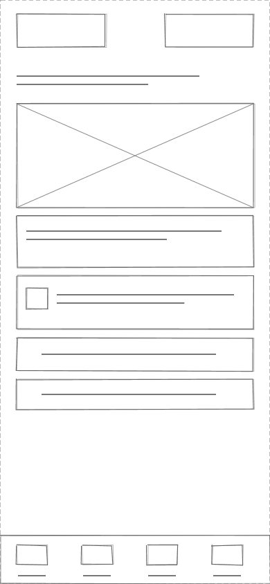</a> | <a href="acceso.png">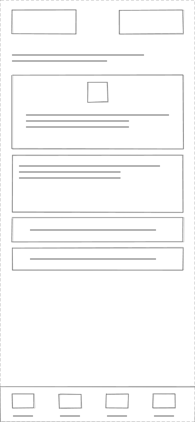</a> | — |

## Hábitos y registros

| **03 Hoy** `hoy` | **04 Mis hábitos** `habitos` | **05 Crear hábito** `habito` |
|---|---|---|
| <a href="hoy.png">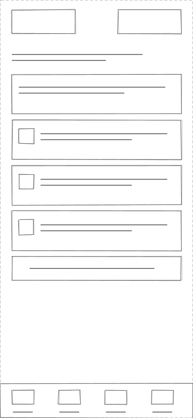</a> | <a href="habitos.png">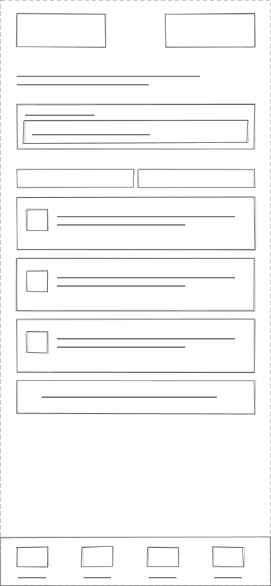</a> | <a href="habito.png">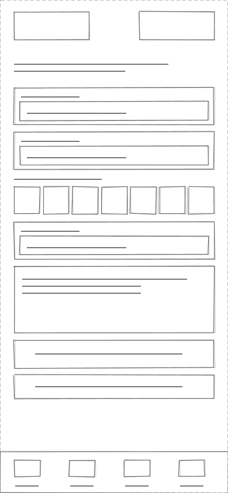</a> |

| **06 Detalle de hábito** `detalle` | **07 Editar programación** `editar` | **08 Registrar avance** `registro` |
|---|---|---|
| <a href="detalle.png">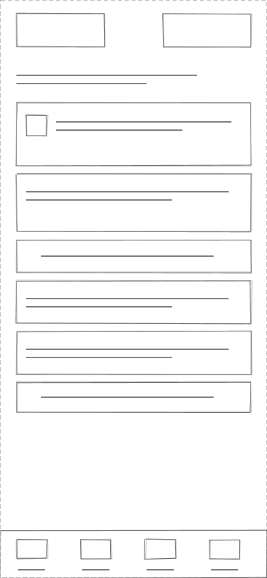</a> | <a href="editar.png">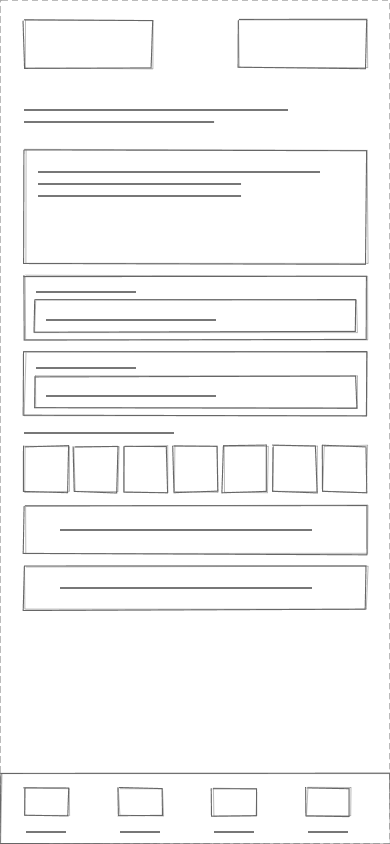</a> | <a href="registro.png">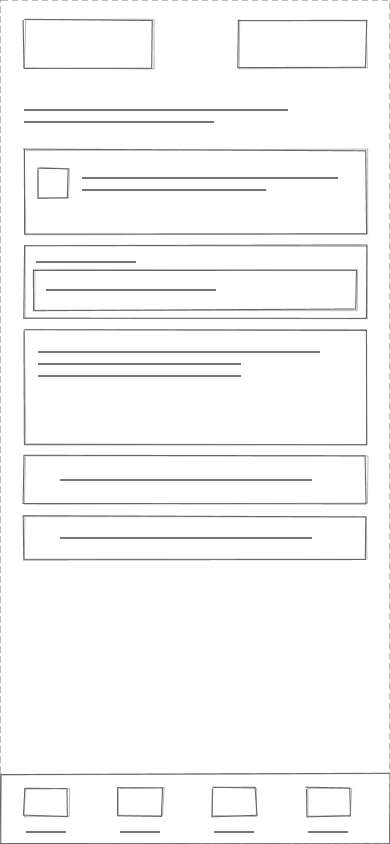</a> |

| **09 Historial de hábito** `historial` | — | — |
|---|---|---|
| <a href="historial.png">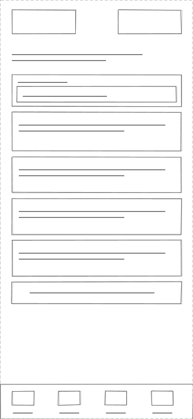</a> | — | — |

## Recordatorios y avisos

| **10 Tu recordatorio** `recordatorio` | **11 Tus avisos** `avisos` | — |
|---|---|---|
| <a href="recordatorio.png">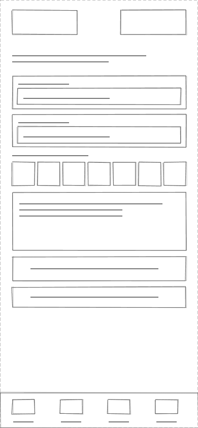</a> | <a href="avisos.png">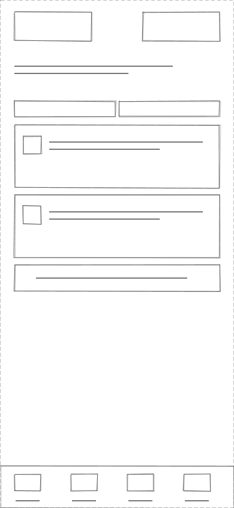</a> | — |

## Análisis y sugerencias

| **12 Análisis** `analisis` | **13 Elegir periodo** `periodo` | **14 Sugerencias** `sugerencias` |
|---|---|---|
| <a href="analisis.png">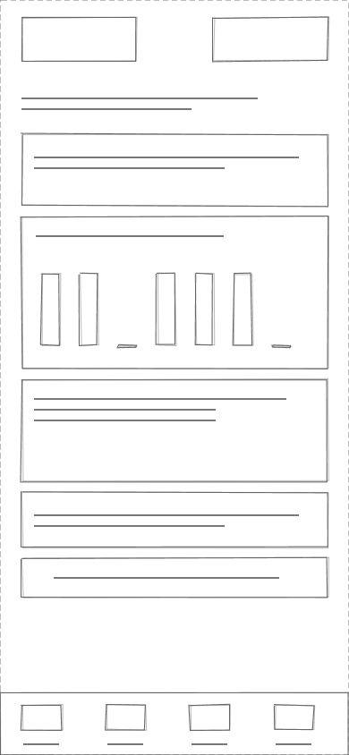</a> | <a href="periodo.png">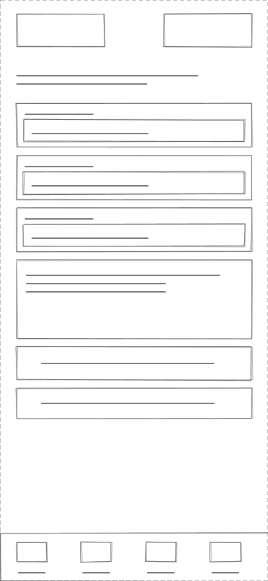</a> | <a href="sugerencias.png">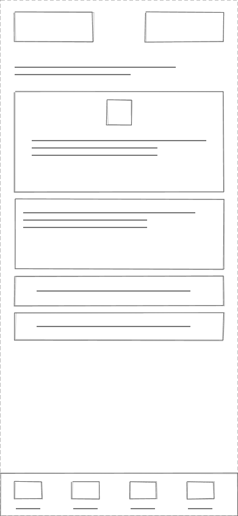</a> |

| **15 Personalizar sugerencia** `personalizar` | — | — |
|---|---|---|
| <a href="personalizar.png">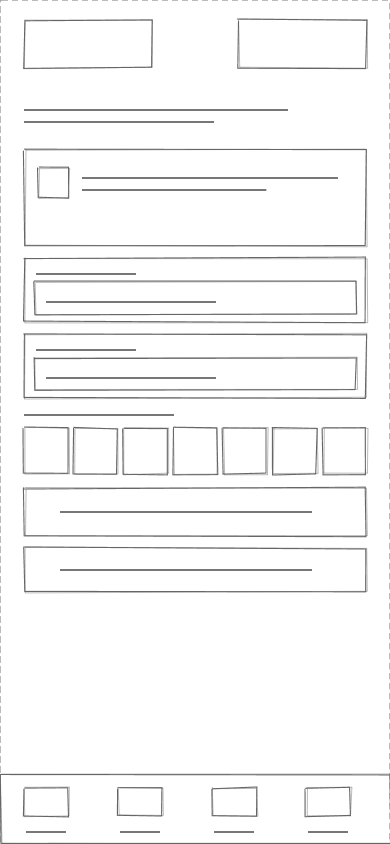</a> | — | — |

## Perfil, privacidad y dispositivos

| **16 Perfil y preferencias** `ajustes` | **17 Consentimiento** `consentimiento` | **18 Dispositivos** `dispositivos` |
|---|---|---|
| <a href="ajustes.png">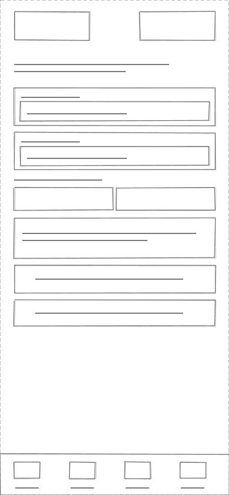</a> | <a href="consentimiento.png">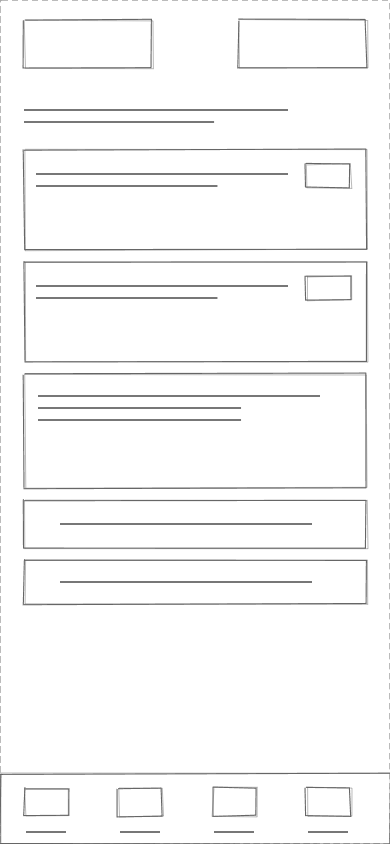</a> | <a href="dispositivos.png">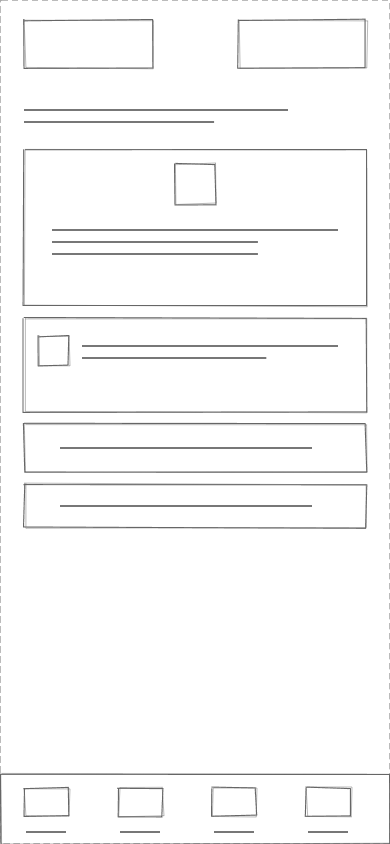</a> |

| **19 Vincular una fuente** `vincular` | **20 Datos personales** `datos` | — |
|---|---|---|
| <a href="vincular.png">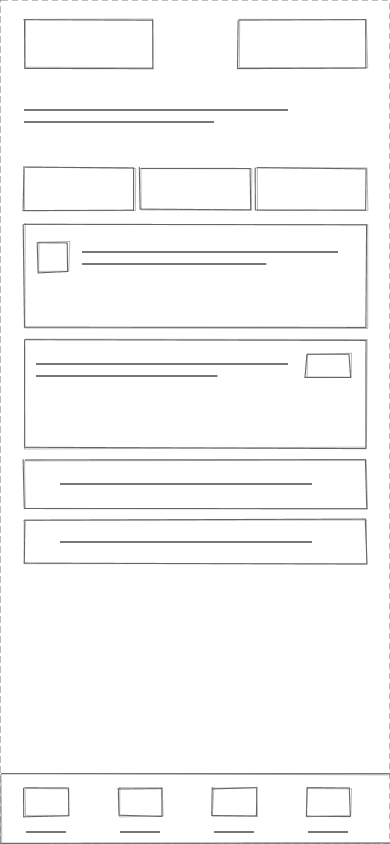</a> | <a href="datos.png">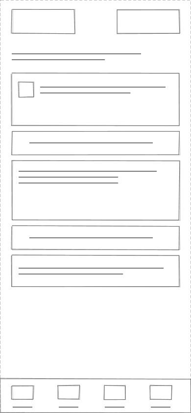</a> | — |
