# Móvil · Wireframes

20 PNG. Misma estructura e intención del sketch, con grises, Arial y marcadores de imagen/logo; sin identidad visual final. Todas las imágenes miden 390 × 844 y son documentación estática.

[Índice y matriz móvil](../README.md) · [Condiciones por pantalla](../README.md#condiciones-por-pantalla) · [Identidad visual](../../../identidad/README.md) · [Galería](../../../index.html#prototipos)

- [Inicio y acceso · 01–02](#inicio-y-acceso)
- [Hábitos y registros · 03–09](#hábitos-y-registros)
- [Recordatorios y avisos · 10–11](#recordatorios-y-avisos)
- [Análisis y sugerencias · 12–15](#análisis-y-sugerencias)
- [Perfil, privacidad y dispositivos · 16–20](#perfil-privacidad-y-dispositivos)

## Inicio y acceso

### Wireframe 01 Bienvenida

ID: `bienvenida`.

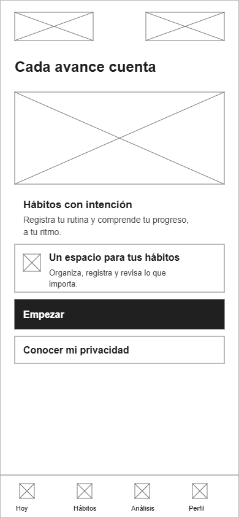

### Wireframe 02 Acceso

ID: `acceso`.

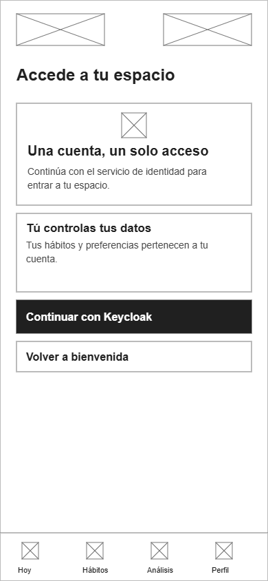

## Hábitos y registros

### Wireframe 03 Hoy

ID: `hoy`.

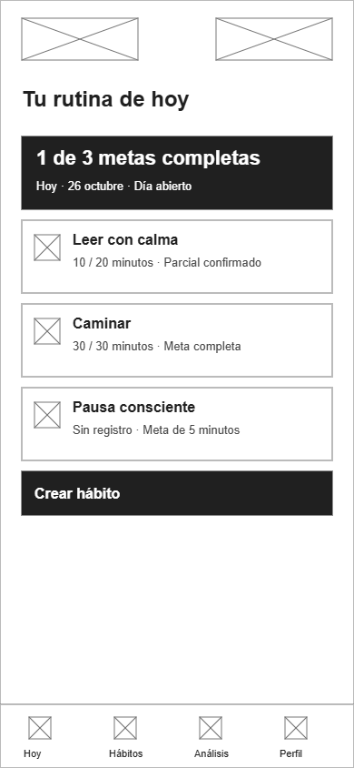

### Wireframe 04 Mis hábitos

ID: `habitos`.

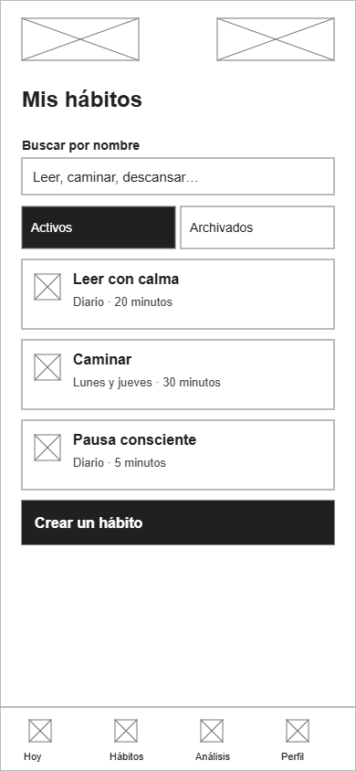

### Wireframe 05 Crear hábito

ID: `habito`.

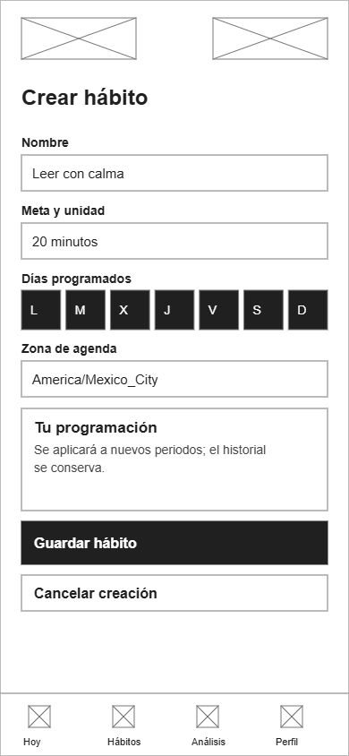

### Wireframe 06 Detalle de hábito

ID: `detalle`.

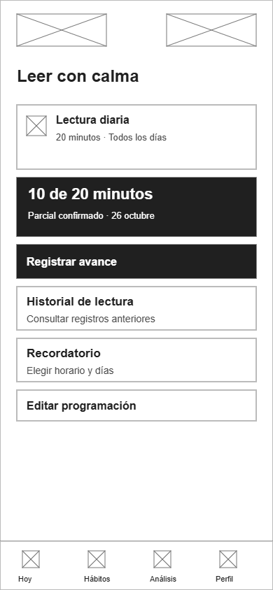

### Wireframe 07 Editar programación

ID: `editar`.

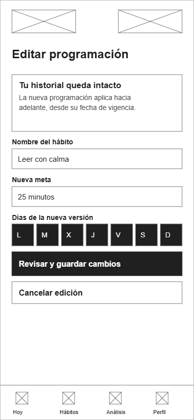

### Wireframe 08 Registrar avance

ID: `registro`.

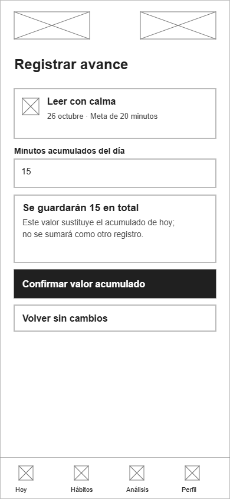

### Wireframe 09 Historial de hábito

ID: `historial`.

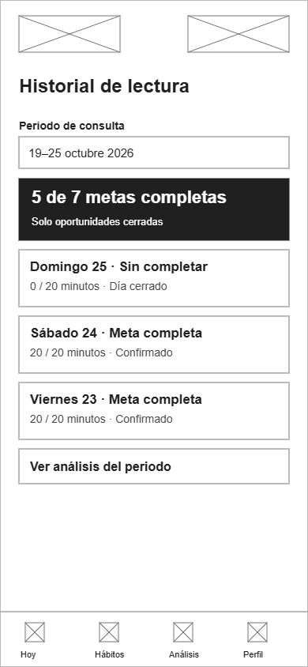

## Recordatorios y avisos

### Wireframe 10 Tu recordatorio

ID: `recordatorio`.

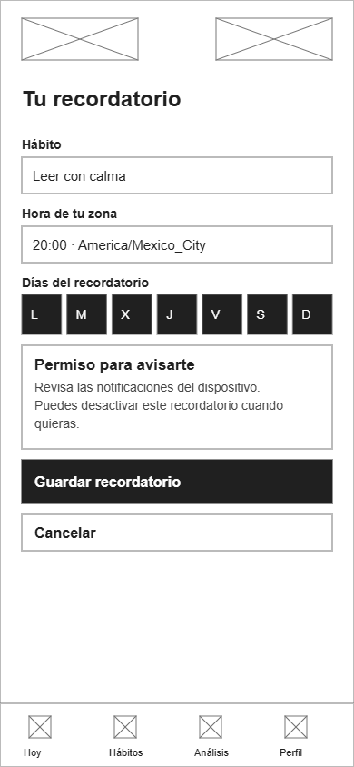

### Wireframe 11 Tus avisos

ID: `avisos`.

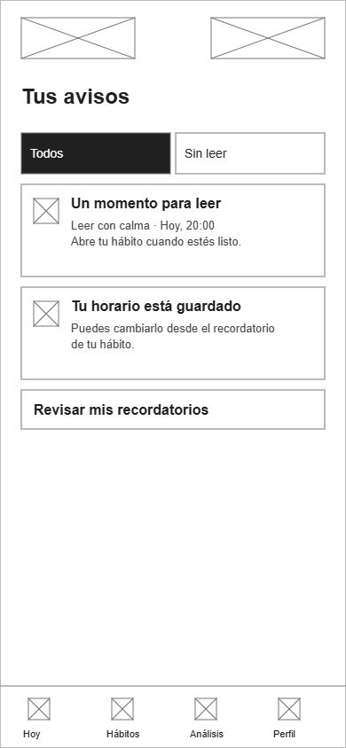

## Análisis y sugerencias

### Wireframe 12 Análisis

ID: `analisis`.

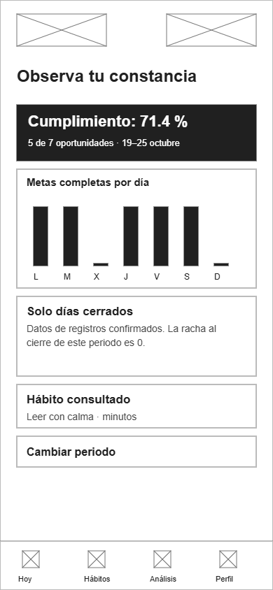

### Wireframe 13 Elegir periodo

ID: `periodo`.

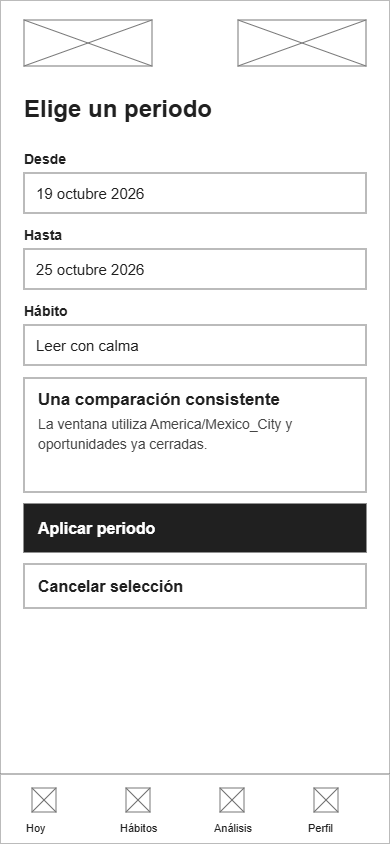

### Wireframe 14 Sugerencias

ID: `sugerencias`.

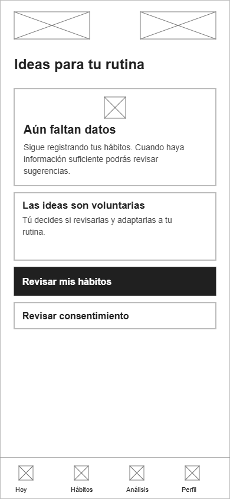

### Wireframe 15 Personalizar sugerencia

ID: `personalizar`.

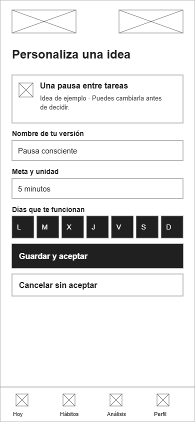

## Perfil, privacidad y dispositivos

### Wireframe 16 Perfil y preferencias

ID: `ajustes`.

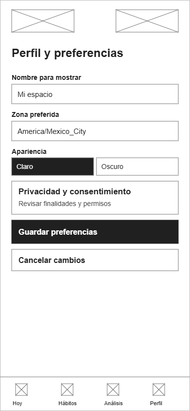

### Wireframe 17 Consentimiento

ID: `consentimiento`.

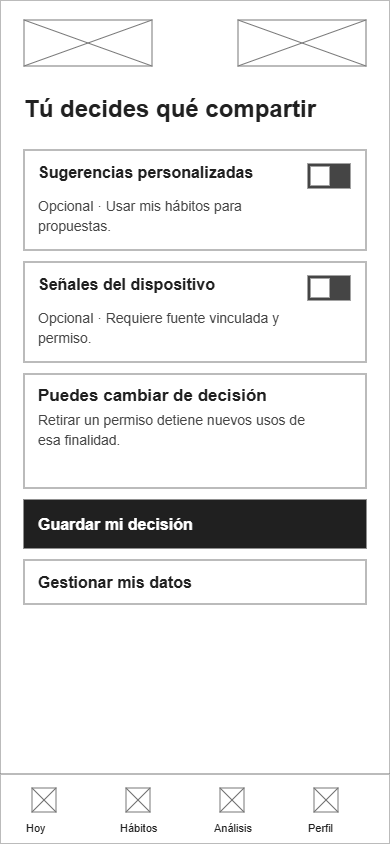

### Wireframe 18 Dispositivos

ID: `dispositivos`.

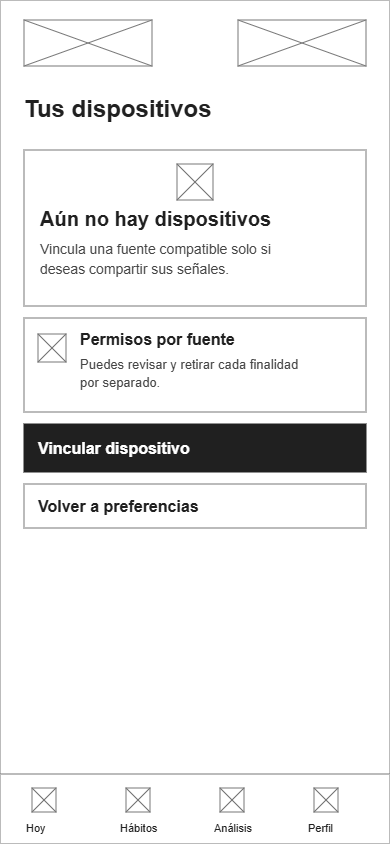

### Wireframe 19 Vincular una fuente

ID: `vincular`.

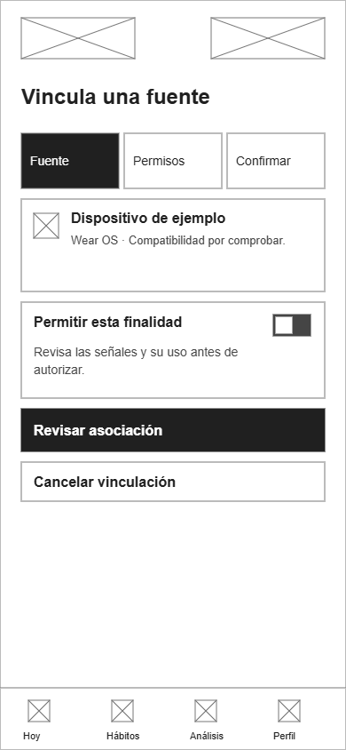

### Wireframe 20 Datos personales

ID: `datos`.

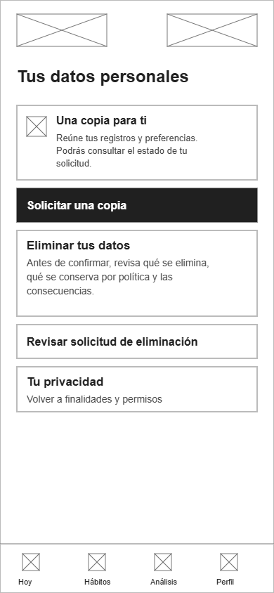
