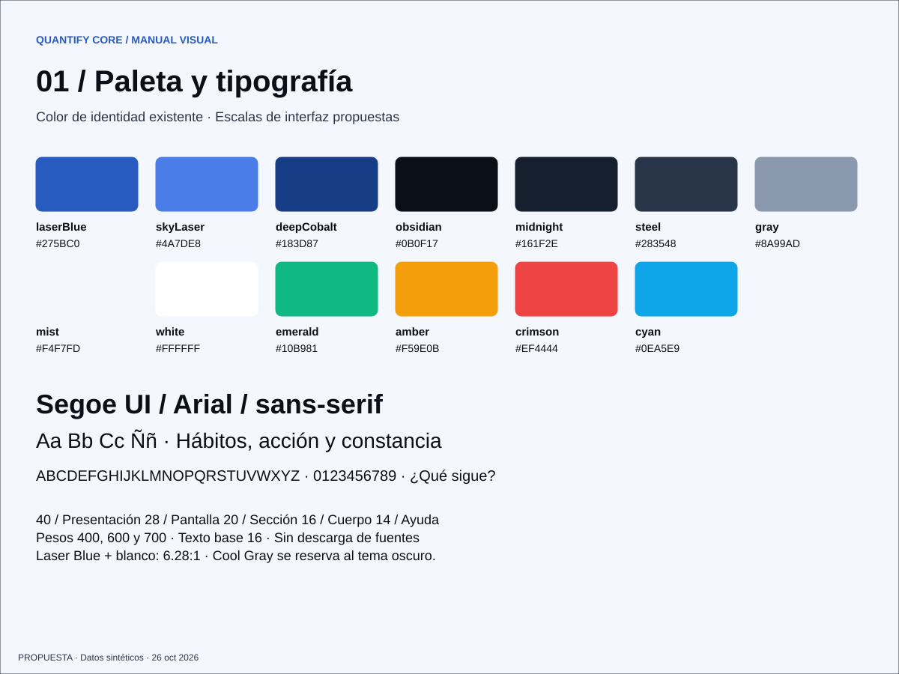
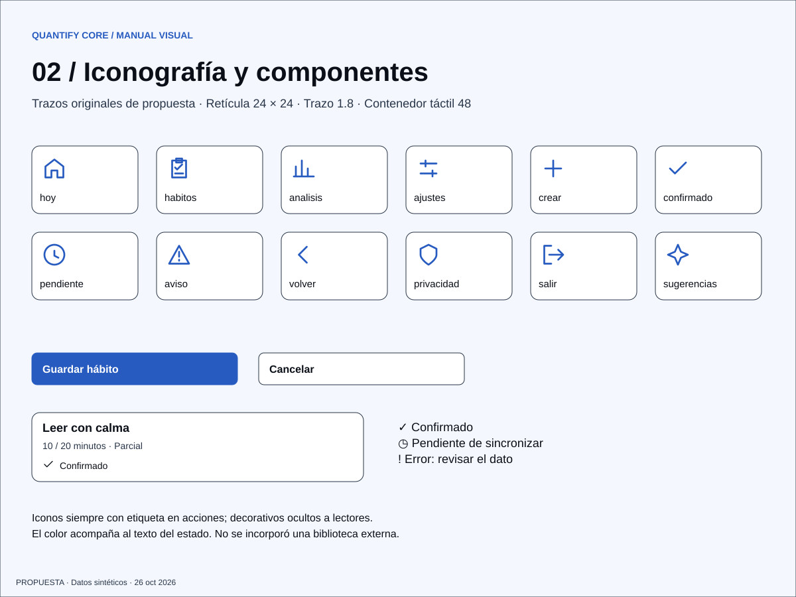
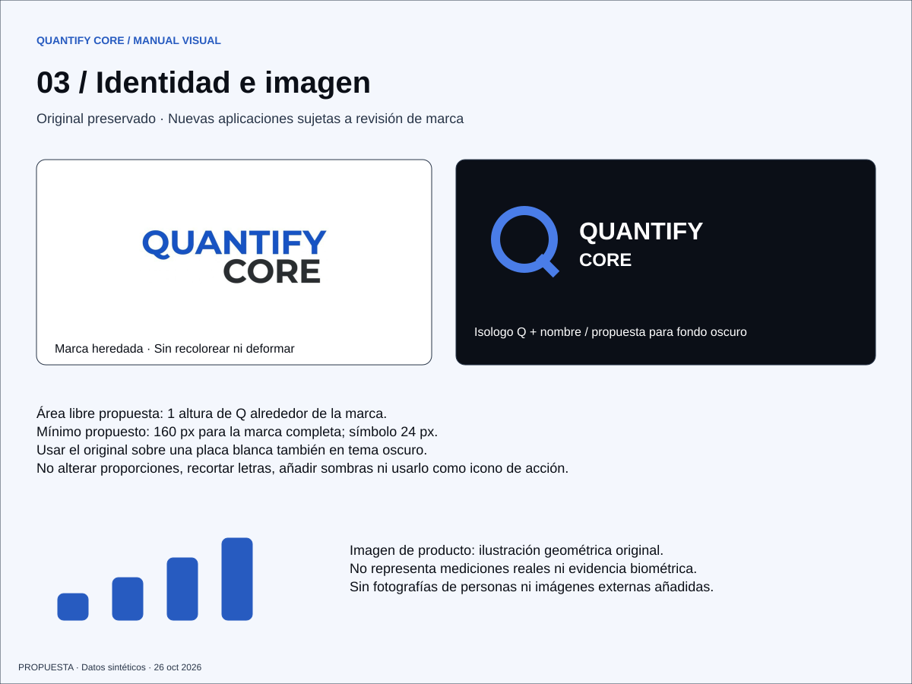

# Manual visual de Quantify Core

Versión de revisión **0.1 · 26 de octubre de 2026**. Actividad: [QUANCORE-26](https://utxicotepec-team-q5ufett6.atlassian.net/browse/QUANCORE-26). [Abrir manual visual](manual-visual.html) · [Explorar prototipos](../GUI/index.html).

La paleta y el logo heredados son referencia existente. Tipografía, iconos, geometría, aplicaciones de marca y temas de esta entrega son **propuestas**, pendientes de revisión del equipo en D-10. No se instala una biblioteca de componentes ni se declaran aprobadas decisiones de marca.

## Paleta y función

La fuente canónica de color sigue siendo el [contrato de tokens](../../packages/design-tokens/README.md). [preview.json](../../packages/design-tokens/preview.json) materializa esos valores y propone roles exclusivamente para las láminas. El generador produce SVG y CSS desde esta misma fuente; no mantener copias manuales CSS/Dart.

| Color | HEX | RGB | Uso y justificación |
|---|---|---|---|
| Laser Blue | `#275BC0` | 39, 91, 192 | Marca y acción principal; jerarquía estable y texto blanco legible |
| Sky Laser | `#4A7DE8` | 74, 125, 232 | Acento y foco oscuro; no texto pequeño blanco encima |
| Deep Cobalt | `#183D87` | 24, 61, 135 | Énfasis y foco claro, con separación del fondo |
| Obsidian Slate | `#0B0F17` | 11, 15, 23 | Fondo oscuro y texto principal claro |
| Midnight Navy | `#161F2E` | 22, 31, 46 | Superficies oscuras para agrupar contenido |
| Steel Border | `#283548` | 40, 53, 72 | Texto secundario claro; divisor decorativo oscuro |
| Cool Gray | `#8A99AD` | 138, 153, 173 | Metadatos oscuros y bordes; no texto sobre blanco |
| Pure Mist | `#F4F7FD` | 244, 247, 253 | Fondo claro que distingue tarjetas blancas |
| Optical White | `#FFFFFF` | 255, 255, 255 | Tarjetas claras y texto oscuro invertido |
| Emerald | `#10B981` | 16, 185, 129 | Acento de éxito, acompañado de «Confirmado» |
| Amber | `#F59E0B` | 245, 158, 11 | Acento de espera; etiqueta «Pendiente» |
| Crimson | `#EF4444` | 239, 68, 68 | Acento de error; mensaje y acción de recuperación |
| Electric Cyan | `#0EA5E9` | 14, 165, 233 | Acento de métricas/IA; sin significado clínico |

Los colores semánticos son acentos de catálogo; las láminas priorizan texto legible y no necesitan utilizarlos todos. La selección no se justifica atribuyendo efectos psicológicos universales a los colores. Su propósito es funcional: coherencia de identidad, jerarquía y estados distinguibles.

Roles claros: fondo Mist, tarjeta White, texto Obsidian, secundario Steel, botón Laser Blue/White. Roles oscuros: fondo Obsidian, tarjeta Midnight, texto White, secundario Cool Gray. Controles con borde Steel en claro y Cool Gray en oscuro; foco Cobalt sobre claro y Sky sobre oscuro. Contrastes y límites de revisión en [validación](../GUI/VALIDACION.md).

## Tipografía y composición

- Familia propuesta: `Segoe UI, Arial, sans-serif`; fuentes del sistema, sin archivos tipográficos ni descarga externa. El logo heredado conserva su dibujo raster, cuya fuente no se presume identificada.
- Escala propuesta: presentación 40, pantalla 28, sección 20, cuerpo 16 y ayuda 14; peso 400, 600 o 700. Las láminas SVG usan medidas fijas de exportación; una implementación debe usar unidades adaptables y probar texto ampliado.
- Muestras: **ÁÉÍÓÚÜÑ áéíóúüñ ¿Cuánto avanzaste? ¡Muy bien! 0123456789**. La legibilidad, disponibilidad local y soporte del español motivan esta elección.
- Espaciado: 4, 8, 12, 16, 24, 32, 48. Radio 8 en controles y 16 en tarjetas; objetivo táctil 48. Excepción visual: selector de días en lámina móvil ocupa 44 de ancho; la aplicación deberá resolver separación y objetivo nativo antes de aprobarlo.
- Móvil: una columna con márgenes 24 en el lienzo 390. Escritorio: navegación 248 y contenido en columnas en el lienzo 1440. La galería a 320 px se reorganiza en una columna; eso no acredita reflujo de una aplicación todavía inexistente.

## Iconografía

Doce SVG originales de esta entrega: retícula 24 × 24, trazo 1.8, extremos/uniones redondos y sin relleno. [Fuentes editables](../GUI/generar-prototipos.py). No se añadió una dependencia ni se atribuye una licencia externa a estos trazos.

| Archivo / semántica | Uso |
|---|---|
| [hoy](recursos/iconos/hoy.svg), [habitos](recursos/iconos/habitos.svg), [analisis](recursos/iconos/analisis.svg), [ajustes](recursos/iconos/ajustes.svg) | Navegación acompañada del nombre de sección |
| [crear](recursos/iconos/crear.svg), [volver](recursos/iconos/volver.svg), [salir](recursos/iconos/salir.svg) | Acciones con verbo explícito |
| [confirmado](recursos/iconos/confirmado.svg), [pendiente](recursos/iconos/pendiente.svg), [aviso](recursos/iconos/aviso.svg) | Estados con texto; no depender del color |
| [privacidad](recursos/iconos/privacidad.svg), [sugerencias](recursos/iconos/sugerencias.svg) | Contexto de finalidad y sugerencias; no garantía de seguridad ni veracidad |

Un icono decorativo debe ocultarse al lector (`aria-hidden`); un control sin texto visible requiere nombre accesible. Para Flutter, conservar semántica y proporciones sin suponer una biblioteca ya elegida. No mezclar estilos de emojis o familias descargadas.

## Identidad, isotipo e isologo

El archivo [quantifyLogo.jpeg](../../assets/images/quantifyLogo.jpeg) se conserva byte por byte, junto con los otros logos heredados. La composición contiene nombre; no se afirma que exista un isotipo oficial independiente.

La propuesta [isologo-propuesto.svg](recursos/isologo-propuesto.svg) combina una Q geométrica con el nombre Quantify Core sobre fondo Obsidian y acento Sky. La Q aislada es un concepto de isotipo, no un icono de aplicación aprobado. No sustituir el original en el README, clientes, favicon ni material oficial sin revisión de marca. La lámina muestra la convivencia del original y la propuesta, no una recoloración automática del JPEG.

| Variante | Tratamiento |
|---|---|
| Existente sobre claro | Usar el JPEG completo manteniendo proporción |
| Existente sobre oscuro | Mantener una placa blanca; no invertir ni filtrar el raster |
| Isologo propuesto sobre oscuro | SVG de revisión; texto blanco y Q Sky, pendiente de aprobación |
| Monocromática o favicon | Pendientes; no derivar automáticamente del JPEG |

Área libre propuesta: altura de la Q a cada lado. Mínimos propuestos: 160 px de ancho para nombre completo y 24 px para símbolo. Comprobar lectura real antes de aprobar. Prohibido deformar, recortar letras, alterar orden, agregar efectos o utilizar la marca como botón de estado.

## Imágenes y procedencia

| Recurso | Fuente / autoría | Tratamiento y límite |
|---|---|---|
| Logo original | Activo heredado del repositorio | Autoría/licencia pendientes según [inventario existente](../../assets/images/README.md); no se modifica |
| [constancia.svg](recursos/constancia.svg) | Geometría original creada con Codex para esta entrega, 26/10/2026 | Ilustración conceptual; no es gráfico de datos ni evidencia de salud |
| Láminas, iconos e isologo propuesto | Dibujos vectoriales originales, generados desde la fuente versionada | Recursos de revisión sujetos a las reglas de distribución del repositorio; no se inventa una licencia |
| Fotos de referencia de la conversación | Referencia aportada por el usuario | Solo inspiran organización de paleta/tipografía/iconos; no se copian imágenes, marca Spotify ni tipografía propietaria |

No se incorporan fotografías ni datos de personas. En una futura foto autorizada: preservar proporciones, no ocultar estados relevantes, optimizar peso y registrar fuente/licencia. Texto alternativo contextual; ilustraciones decorativas con `alt=""`. La gráfica de Análisis incluye valores equivalentes en texto dentro de la lámina y la matriz enlazada.

## Regeneración y revisión

Desde la raíz: `python docs/GUI/generar-prototipos.py` con Python 3. Los SVG son entregables editables y exportables; el generador es su fuente. Para cambiar un color, editar `preview.json`, regenerar y revisar ambos temas. Las pantallas no son capturas de React/Flutter ni evidencias de backend.

Revisar [sistema de diseño](sistema-diseno.md), [recorridos](recorridos.md), [matriz de pantallas](../GUI/matriz-pantallas.md) y [validación](../GUI/VALIDACION.md). Quedan abiertas aprobación visual, pruebas con usuarios y accesibilidad nativa. El ticket continúa abierto; estos documentos no cumplen por sí solos su implementación de producto.
