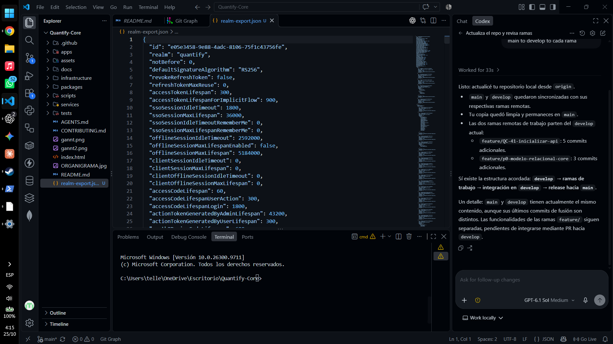
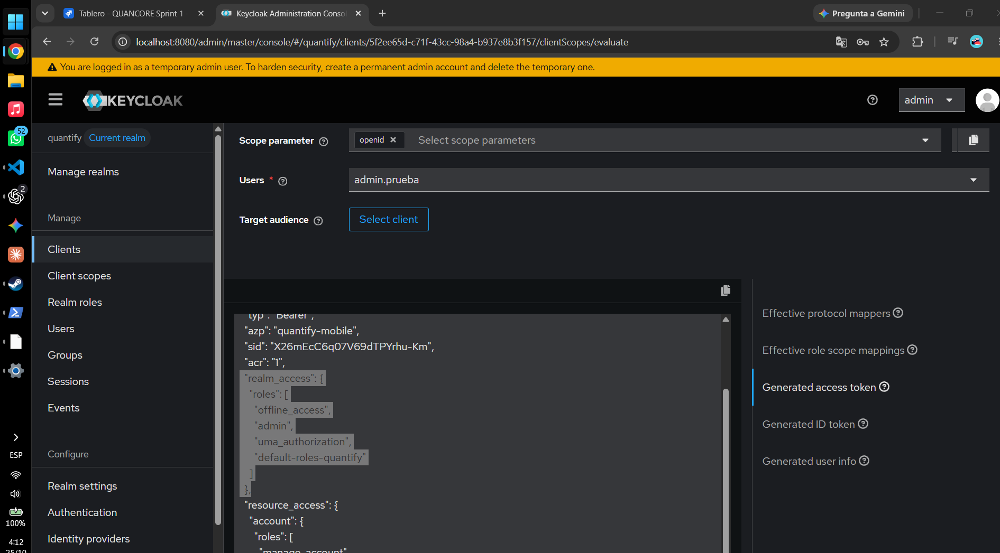
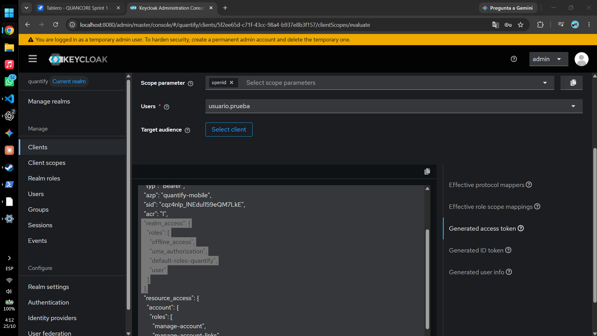
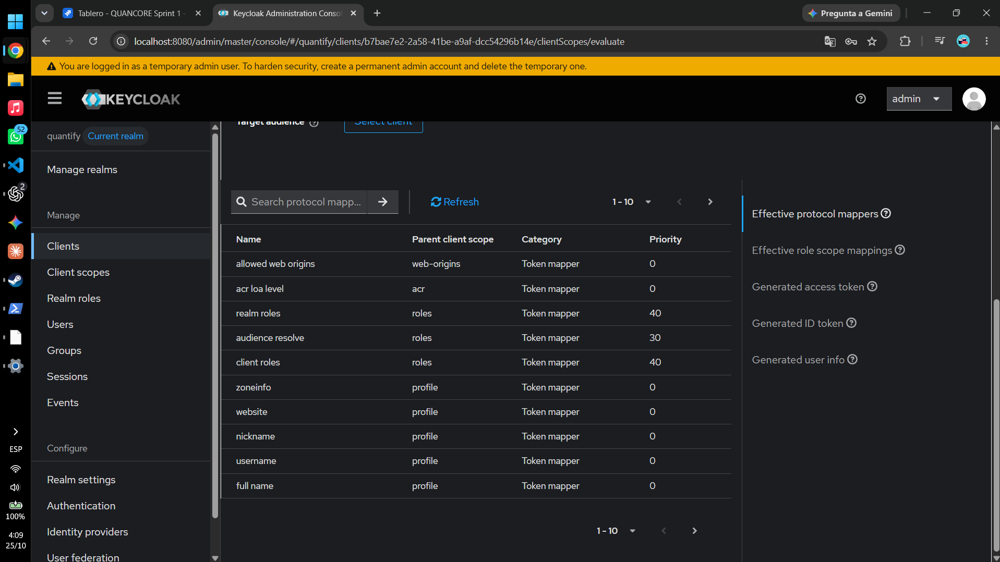
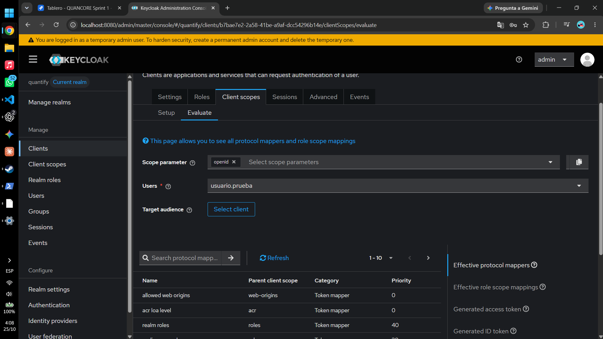
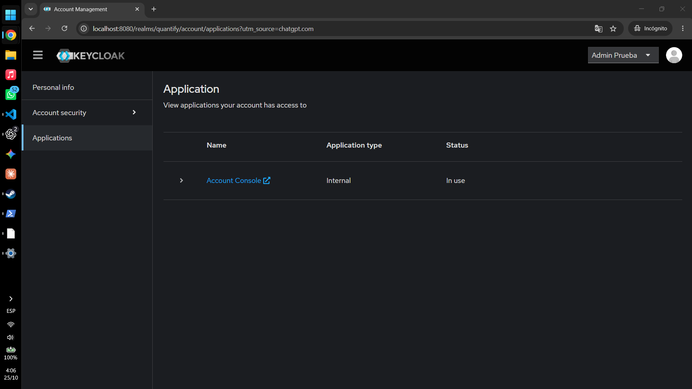
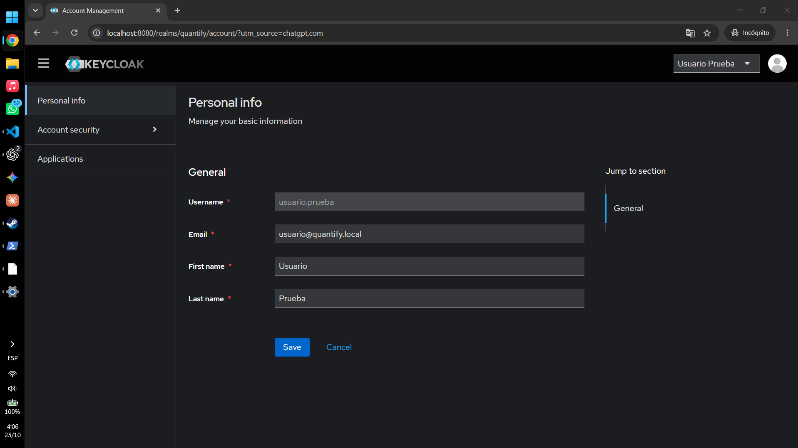
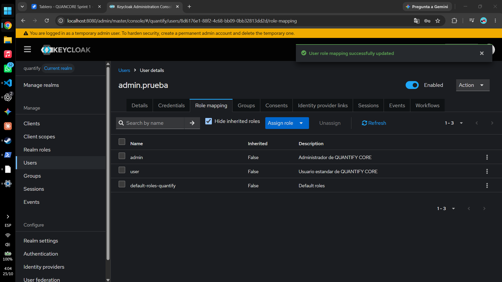
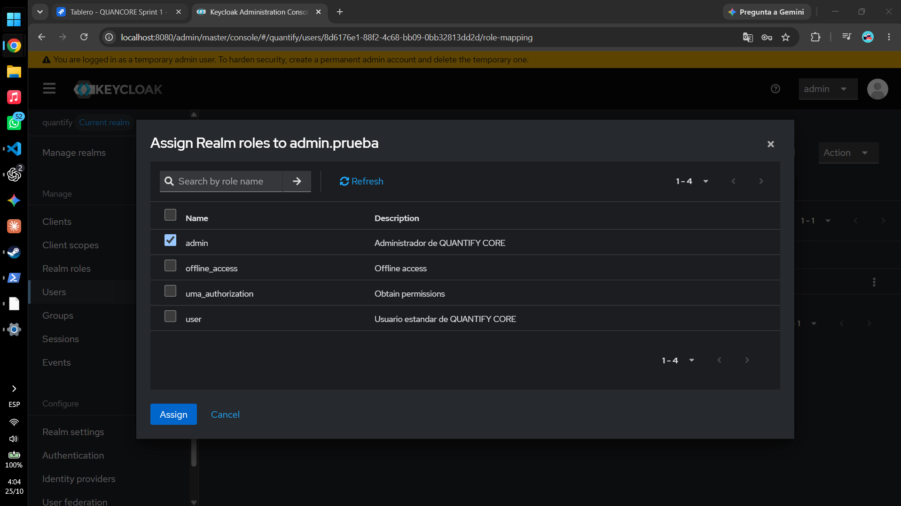
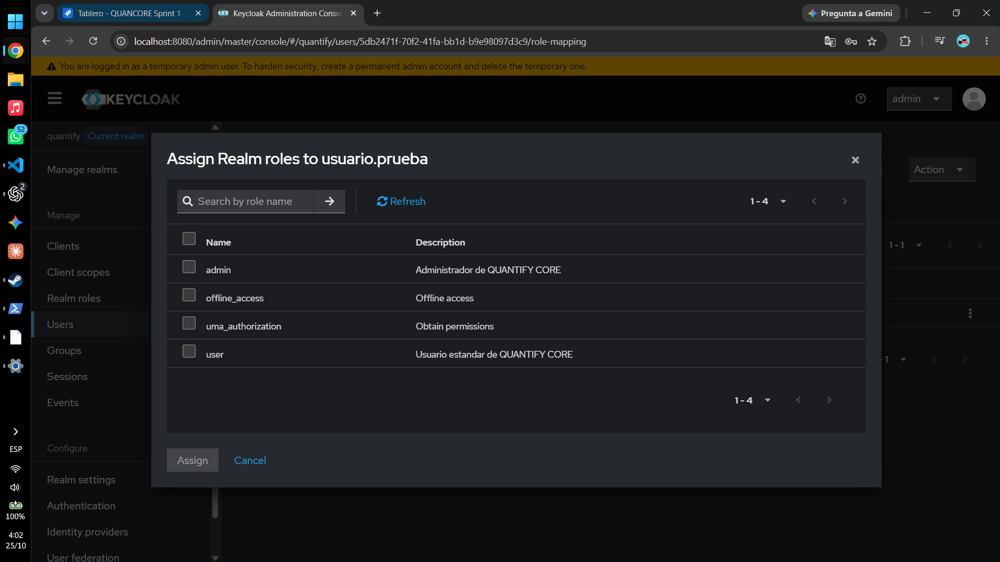

**Ubicación:** [Quantify-Core](../../README.md) → [infrastructure](../README.md) → keycloak · **Nivel 2**

# Keycloak para QUANTIFY CORE

Guía única de configuración y evidencia del laboratorio **QUANCORE-17**, relacionado con [RF-01](../../docs/requerimientos/catalogo.md) y las [reglas de seguridad](../../docs/seguridad/README.md). Revisión original: 25 de octubre de 2026.

## Contenido

- [Qué se realizó y qué contiene esta carpeta](#qué-se-realizó-y-qué-contiene-esta-carpeta)
- [Configuración auditada](#configuración-auditada)
- [Requisitos y estado del entorno](#requisitos-y-estado-del-entorno)
- [Usar una instalación existente](#usar-una-instalación-existente)
- [Crear un laboratorio nuevo e importar](#crear-un-laboratorio-nuevo-e-importar)
- [Reproducir la configuración manualmente](#reproducir-la-configuración-manualmente)
- [Aprovisionar cuentas de prueba fuera de Git](#aprovisionar-cuentas-de-prueba-fuera-de-git)
- [Operación y diagnóstico](#operación-y-diagnóstico)
- [Siguiente integración y producción](#siguiente-integración-y-producción)
- [Pruebas realizadas y cómo repetirlas](#pruebas-realizadas-y-cómo-repetirlas)
- [Referencias oficiales](#referencias-oficiales)
- [Procedencia e integridad de las capturas](#procedencia-e-integridad-de-las-capturas)
- [Glosario de evidencias de Keycloak](#glosario-de-evidencias-de-keycloak)

## Qué se realizó y qué contiene esta carpeta

Se configuró el laboratorio con Docker y **Keycloak 26.8.1**, comando `start-dev`, acceso local `http://localhost:8080`, realm `quantify`, clientes públicos web/móvil y roles `user`/`admin`. Se incorporó el export auditado y se verificó su importación en un contenedor aislado. Las capturas aportadas documentan sesiones históricas del portal de cuentas y simulaciones de roles; se interpretan individualmente al final.

| Recurso | Función |
|---|---|
| [realm-export.json](realm-export.json) | Configuración importable del realm y sus clientes; no incluye usuarios, contraseñas ni secretos detectados |
| Este README | Configuración, instalación, operación, pruebas, límites y diez capturas con pie descriptivo |
| [Validador estático](../../scripts/check-keycloak.mjs) | Comprueba JSON, controles de los clientes y patrones potencialmente sensibles |
| `docs/evidencias/keycloak/` | Almacena las diez imágenes originales; se muestran al final de este documento |

El archivo original que estaba sin seguimiento en la raíz se preservó íntegro en `.git/quancore-17-private/realm-export.original.json`, fuera del índice, antes de normalizar el formato e incorporarlo aquí. No publicar ese respaldo ni añadir exports nuevos sin auditarlos.

**Alcance:** esta configuración no implementa el login/callback OAuth de React o Flutter ni la validación y autorización de tokens en NestJS. La decisión web SPA/BFF D-02 sigue abierta. Una sesión real en Account Console y un resultado simulado de Evaluate no acreditan la integración de las aplicaciones de producto.

## Configuración auditada

| Parámetro | quantify-web | quantify-mobile |
|---|---|---|
| Protocolo | OpenID Connect | OpenID Connect |
| Tipo / Client authentication | Público / Off | Público / Off |
| Standard flow | On: Authorization Code | On: Authorization Code |
| PKCE code challenge method | S256 | S256 |
| Direct access grants | Off | Off |
| Implicit flow / Service accounts | Off / Off | Off / Off |
| Valid redirect URIs | `http://localhost:5173/*` | `com.quantify.app:/oauth2redirect` |
| Web origins | `http://localhost:5173` | Vacío; una app nativa no necesita CORS del navegador |
| Default client scope `roles` | Incluido | Incluido |
| Full scope allowed | On en laboratorio | On en laboratorio |

El comodín web reproduce el export recibido, restringido a localhost. Cuando exista una ruta real de callback, sustituirlo por su URI exacta; no inventar hoy un callback implementado. No usar `*` como origen CORS. El callback móvil requiere que Flutter/Android/iOS registren y validen el esquema; guardar la URI en Keycloak no registra ese esquema en el sistema operativo. En dispositivos/emuladores, `localhost` no apunta necesariamente a la PC: definir red, emisor y hostname de forma consistente antes de integrar.

Los roles de realm son `user` y `admin`, ambos no compuestos. El rol `admin` de QUANTIFY CORE no equivale a administrar Keycloak y no concede acceso general a hábitos o biometría privados. La API futura debe comprobar permiso y propiedad. No asignar `realm-admin` a las cuentas de demo.

Los clientes internos de Keycloak también aparecen en el export; no confundirlos con los dos clientes de producto. Por ejemplo, `admin-cli` conserva su configuración interna de direct grants. La comprobación de direct grants deshabilitados se aplica a `quantify-web` y `quantify-mobile`.

## Requisitos y estado del entorno

- Docker Desktop funcionando con contenedores Linux; conexión al registro para descargar la imagen si no existe.
- Puerto local 8080 disponible para una instalación nueva. Node.js para comprobar export y documentación; se verificó con Node 24.14.1 y Docker 29.7.2.
- Credenciales nuevas elegidas localmente y fuera de Git. No usar contraseñas comunes ni escribirlas en comandos, capturas o Jira.
- Ejecutar los ejemplos PowerShell desde la raíz del repositorio. Los comandos de inicio son procedimientos reproducibles; consultar la sección de pruebas de este documento para distinguir los resultados observados de los procedimientos propuestos.

En esta revisión ya existía `quantify-keycloak`, con imagen 26.8.1, comando `start-dev`, puerto `127.0.0.1:8080` y volumen `quantify-keycloak-data` montado en `/opt/keycloak/data`. Se preservó ese entorno. **No ejecutar otro `docker run` con el mismo nombre ni eliminar su volumen.**

## Usar una instalación existente

```powershell
docker ps -a --filter name=quantify-keycloak
# Solo si está detenido:
docker start quantify-keycloak
docker logs --tail 80 quantify-keycloak
```

Abrir la [consola administrativa](http://localhost:8080/admin/) y seleccionar `quantify`, evitando modificar `master` como realm de producto. Comprobar descubrimiento sin credenciales:

```powershell
$oidc = Invoke-RestMethod 'http://localhost:8080/realms/quantify/.well-known/openid-configuration'
$oidc.issuer
$oidc.code_challenge_methods_supported
```

Resultado esperado: emisor `http://localhost:8080/realms/quantify`; soporte de S256. El descubrimiento puede anunciar también `plain`: la restricción S256 se configura en cada cliente y se comprueba en el export. Anunciar S256 no prueba por sí solo su exigencia en una aplicación.

## Crear un laboratorio nuevo e importar

Este procedimiento requiere que no exista el contenedor del mismo nombre ni un realm previo en el volumen seleccionado. Si ya hay datos, usar el entorno existente o elegir otro nombre, puerto y volumen; no borrarlos para reproducir la guía. El ejemplo crea un volumen de desarrollo persistente, no una base productiva.

```powershell
node scripts/check-keycloak.mjs
$realmFile = (Resolve-Path 'infrastructure/keycloak/realm-export.json').Path
$iamBootstrapPassword = Read-Host 'Contraseña nueva para el administrador temporal' -AsSecureString
$env:KC_BOOTSTRAP_ADMIN_PASSWORD = [System.Net.NetworkCredential]::new('', $iamBootstrapPassword).Password
try {
    if ([string]::IsNullOrWhiteSpace($env:KC_BOOTSTRAP_ADMIN_PASSWORD)) { throw 'La contraseña no puede estar vacía' }
    docker run -d --name quantify-keycloak -p 127.0.0.1:8080:8080 -e KC_BOOTSTRAP_ADMIN_USERNAME=admin -e KC_BOOTSTRAP_ADMIN_PASSWORD -v quantify-keycloak-data:/opt/keycloak/data --mount "type=bind,source=$realmFile,target=/opt/keycloak/data/import/quantify-realm.json,readonly" quay.io/keycloak/keycloak:26.8.1 start-dev --import-realm
    if ($LASTEXITCODE -ne 0) { throw 'Docker no pudo crear el laboratorio; revisar nombre, puerto y logs' }
} finally {
    Remove-Item Env:KC_BOOTSTRAP_ADMIN_PASSWORD -ErrorAction SilentlyContinue
    Remove-Variable iamBootstrapPassword -ErrorAction SilentlyContinue
}
docker logs --tail 80 quantify-keycloak
```

El montaje renombra el archivo a `quantify-realm.json`, conforme a la convención de importación. `--import-realm` omite un realm que ya existe: editar el JSON y reiniciar no lo actualiza. No sobrescribir una instancia en uso; aplicar los cambios explícitamente en consola tras revisión, o probar la importación en un laboratorio aislado. El export no es un respaldo completo de usuarios, sesiones, eventos o base de datos.

`-e KC_BOOTSTRAP_ADMIN_PASSWORD` hereda la variable de esta misma sesión PowerShell. El error `bootstrap-admin-username available only when bootstrap admin password is set` indica que no llegó la contraseña; volver a leerla de forma segura en esa sesión. No reemplazar el texto de la pregunta de `Read-Host` por la contraseña. No publicar `docker inspect` completo: las variables del contenedor pueden revelar el secreto aunque se retire de la terminal.

**Administrador temporal:** Keycloak lo crea en `master` durante el bootstrap inicial. El aviso amarillo en las capturas exige crear un administrador permanente con acceso mínimo y MFA, comprobar su acceso y eliminar manualmente la cuenta temporal. Cambiar una variable de bootstrap no rota la contraseña de una cuenta ya creada. `admin.prueba` es una cuenta de producto en `quantify`, distinta de ese administrador temporal.

## Reproducir la configuración manualmente

Si no se importa el export, crear `quantify` habilitado desde **Manage realms**. En **Clients**, crear cada cliente con los valores de la tabla y guardar también la sección **Advanced → Proof Key for Code Exchange → S256**. Los nombres de secciones pueden variar con la consola; confirmar el atributo `pkce.code.challenge.method` en el export. En **Realm roles**, crear `user` y `admin`.

En cada cliente, verificar **Client scopes**: el scope `roles` debe estar asignado por defecto y su mapper de realm roles debe escribir `realm_access.roles` en el access token. No introducir un secreto para un cliente público ni habilitar password grant para simplificar las pruebas.

## Aprovisionar cuentas de prueba fuera de Git

El export original **no contiene `users`**. Importarlo no crea estas cuentas ni sus contraseñas. Las capturas muestran cuentas existentes en el laboratorio anterior. Para reproducirlas, en **Users → Add user** crear:

| Username | Nombre sintético | Realm role mínimo |
|---|---|---|
| `usuario.prueba` | Usuario Prueba | `user` |
| `admin.prueba` | Admin Prueba | `admin` |

Si el perfil exige correo, usar exclusivamente direcciones sintéticas del laboratorio, sin datos reales. En **Credentials → Set password**, introducir un valor nuevo localmente. Usar contraseña temporal y completar el cambio en la primera sesión; si se desactiva temporalidad para una demo controlada, registrar ese alcance y rotarla al terminar. En **Role mapping → Assign role**, filtrar por realm roles y asignar los de la tabla.

Una captura histórica muestra `admin.prueba` con `admin` y `user`; la simulación móvil posterior muestra `admin` sin `user`. No asumir equivalencia ni herencia: ambos roles son no compuestos. Para este laboratorio basta el rol mínimo `admin`; si el producto necesita ambos, acordarlo y repetir las cuatro evaluaciones. No inventar que esa discrepancia quedó resuelta en el servidor.

Para el login real, abrir una ventana privada en [portal de cuentas](http://localhost:8080/realms/quantify/account/), iniciar sesión con cada cuenta por separado, completar acciones requeridas y comprobar la identidad. Cerrar sesión antes de cambiar de cuenta. Esto demuestra autenticación en el cliente interno Account Console; no demuestra redirección ni canje de código en React/Flutter.

## Operación y diagnóstico

```powershell
docker ps --filter name=quantify-keycloak
docker logs --tail 80 quantify-keycloak
docker logs --follow quantify-keycloak
# Ctrl+C termina el seguimiento de logs, no el servidor.
docker stop quantify-keycloak
docker start quantify-keycloak
```

La parada y el arranque conservan el volumen. No ejecutar `docker volume rm` ni una limpieza con volúmenes para detener el servicio. Revisar y sanear los logs antes de compartirlos. No exportar ni copiar tokens completos.

| Síntoma | Comprobación y acción |
|---|---|
| Puerto ocupado / nombre existente | Revisar `docker ps -a`; usar el contenedor existente o otro laboratorio, sin borrar datos |
| Realm no aparece tras editar JSON | La importación inicial omite realms existentes; comprobar logs y usar configuración explícita o laboratorio limpio |
| `Invalid redirect_uri` | Comparar literalmente la URI solicitada con la lista; no ampliar a `*` |
| Login pide actualizar perfil/contraseña | Completar acciones requeridas de esa cuenta; no desactivar controles globales para evitarlas |
| Falta `realm_access.roles` | Revisar rol de usuario, scope `roles`, mapper y selección de cuenta/cliente en Evaluate |
| Móvil no vuelve a la app | Revisar esquema/callback del sistema operativo y red del dispositivo; integración aún pendiente |

## Siguiente integración y producción

Pendientes: SDK OIDC web/móvil con navegador del sistema cuando corresponda, generación/verificación de PKCE, `state` y `nonce`, callback real, renovación y logout; audiencia de API y validación de firma/JWKS, `iss`, `aud`, vigencia, rol y propiedad en NestJS; pruebas de acceso permitido y denegado. No usar un ID token como bearer de la API.

Antes de producción, resolver D-02 y D-08, fijar versión/digest y mantenimiento de seguridad, ejecutar `start` con configuración productiva, HTTPS y hostname/emisor estables, base externa soportada (por ejemplo PostgreSQL), secretos gestionados fuera de Git, respaldo/restauración comprobados, MFA administrativo, cuentas de mínimo privilegio, límites de sesión, fuerza bruta, registro de eventos sin tokens y monitorización. Reducir redirects a rutas exactas y scopes a lo necesario. `start-dev`, HTTP local y un volumen Docker no equivalen a un despliegue productivo ni a una estrategia de recuperación.

## Pruebas realizadas y cómo repetirlas

La revisión original se realizó con Windows/PowerShell, Node.js **24.14.1**, Docker cliente/servidor **29.7.2** y la imagen Keycloak **26.8.1**. Los resultados siguientes son históricos y no se presentan como pruebas de login repetidas en cada cambio documental.

| Comprobación ejecutada | Resultado y alcance |
|---|---|
| Auditoría del export y comparación con el original | JSON semánticamente idéntico, sin usuarios, contraseñas, secretos de cliente, claves privadas ni JWT detectados. Los dos campos `authenticatorConfig.*.config.credentials` contienen el identificador de tipo `webauthn-passwordless`, no credenciales |
| `node scripts/check-keycloak.mjs` | Realm, roles, clientes públicos, S256, redirects, grants deshabilitados y mapper `realm_access.roles` correctos |
| Seis controles negativos con copias sintéticas temporales | Rechazó secreto de cliente, credenciales de usuario, clave privada, JWT compacto, PKCE plain y direct grants activados |
| Inspección selectiva del servidor existente | `quantify-keycloak`, `start-dev`, loopback 8080 y volumen `quantify-keycloak-data`; sin mostrar variables secretas |
| Discovery del realm existente | Respuesta satisfactoria con issuer `http://localhost:8080/realms/quantify` y soporte S256 |
| Importación aislada del JSON versionado | Contenedor temporal `quantify-keycloak-quancore17-check`, puerto loopback 18080, sin volumen existente ni bootstrap admin. Logs: `Realm 'quantify' imported` e `Import finished successfully`; discovery respondió |
| Limpieza del ensayo | Contenedor temporal detenido y eliminado mediante `--rm`; servidor, cuentas y volumen originales preservados |
| Integridad de capturas | Diez PNG sin editar; hashes SHA-256 conservados debajo |

El ensayo aislado montó el JSON como `/opt/keycloak/data/import/quantify-realm.json` y ejecutó `start-dev --import-realm` con la misma imagen 26.8.1. No se aprovisionaron usuarios ni se probaron credenciales dentro de ese contenedor. La auditoría estática y la aceptación del JSON no garantizan ausencia absoluta de secretos arbitrarios ni sustituyen pruebas de autenticación.

### Verificar los archivos desde la raíz del repositorio

```powershell
node scripts/check-keycloak.mjs
node scripts/check-docs.mjs
git diff --check
```

El primer comando valida el export; el segundo comprueba enlaces, capitalización, bloques y referencias documentales; el tercero detecta errores de espacios. No certifican endpoints ni permisos de negocio implementados.

### Repetir autenticación y evaluación de roles

1. Aprovisionar las cuentas según la guía. En una ventana privada abrir `http://localhost:8080/realms/quantify/account/`, iniciar sesión con cada cuenta por separado, completar las acciones requeridas, verificar el username y cerrar sesión antes de cambiar de cuenta. No capturar contraseñas ni cookies.
2. En consola administrativa → realm `quantify` → **Clients → quantify-web → Client scopes → Evaluate**, seleccionar scope `openid` y `usuario.prueba`. Abrir **Generated access token** y revisar `azp` y `realm_access.roles` en el JSON simulado. No copiar el JWT completo.
3. Repetir con `admin.prueba` y luego repetir ambos casos en `quantify-mobile`.

| Cliente y cuenta | Resultado esperado de roles de producto | Evidencia disponible |
|---|---|---|
| Web / `usuario.prueba` | Incluye `user`; no `admin` | K-04/K-05 muestran mapper/evaluación, pero falta el resultado de claims |
| Web / `admin.prueba` | Incluye `admin`; registrar si también tiene `user` | Falta captura del resultado |
| Móvil / `usuario.prueba` | Incluye `user`; no `admin` | Simulación histórica K-03 |
| Móvil / `admin.prueba` | Incluye `admin`; registrar si también tiene `user` | Simulación histórica K-02; diferencia con K-08 pendiente |

Los roles `offline_access`, `uma_authorization` y `default-roles-quantify` no son los permisos de negocio `user`/`admin`. El orden del arreglo no importa. K-07 muestra el username de usuario autenticado; K-06 muestra el nombre Admin Prueba, pero no su username. No se repitieron esos logins durante la revisión del repositorio.

**Pendiente de evidencia:** resultados web de ambas cuentas, username de administrador en el portal y repetición que explique la diferencia de roles de `admin.prueba`. Conservar las capturas reales en `docs/evidencias/keycloak/` tras revisar secretos; no crear imágenes de sustitución.

**Pendiente de producto:** login/callback y canje con PKCE real, validación de `state`/`nonce`, logout/renovación, rechazo de verifier o redirect incorrectos y autorización NestJS con firma/JWKS, issuer, audiencia, vigencia, rol y propiedad. Evaluar también suspensión/revocación y acceso permitido/denegado. Estos resultados no están acreditados por las capturas.

## Referencias oficiales

- [Keycloak en contenedores](https://www.keycloak.org/server/containers): imagen, desarrollo y configuración de ejecución.
- [Importación y exportación](https://www.keycloak.org/server/importExport): nombres de archivo, importación inicial y límites del respaldo.
- [Bootstrap y recuperación de administradores](https://www.keycloak.org/server/bootstrap-admin-recovery): cuenta temporal y eliminación manual.
- [Administración de Keycloak](https://www.keycloak.org/docs/latest/server_admin/index.html): clientes OIDC, usuarios, roles y evaluación de scopes.

Las referencias `latest` pueden cambiar; la imagen y el export examinados corresponden a 26.8.1.

## Procedencia e integridad de las capturas

Diez imágenes originales recuperadas de la conversación «Configurar Keycloak en Jira». Se conservaron sin editar tras revisión visual; los nombres y correo visibles corresponden a cuentas sintéticas. Los nombres originales contienen `20261025`; sus horas no se interpretan como hora local validada. No hay contraseñas ni JWT compactos visibles.

<details>
<summary>Archivos originales y hashes SHA-256</summary>

| ID | Archivo | Original | SHA-256 |
|---|---|---|---|
| K-01 | [01-repo-inicial.png](../../docs/evidencias/keycloak/01-repo-inicial.png) | image(20261025-221606).png | `04bfdeb2f1aed800544917bcf4130f84861aea13d8dbdeb2198e94d65237cb49` |
| K-02 | [02-mobile-admin-evaluate.png](../../docs/evidencias/keycloak/02-mobile-admin-evaluate.png) | image(20261025-221245).png | `426f06605fc7304c4c0f540f186fe2a773be0edd2786e57b5d451e50f651b5b3` |
| K-03 | [03-mobile-user-evaluate.png](../../docs/evidencias/keycloak/03-mobile-user-evaluate.png) | image(20261025-221238).png | `f93bb68c3f4cb2d314b1ca3f714458623e0d42629c234299b3acf85e7c1b370d` |
| K-04 | [04-web-mappers.png](../../docs/evidencias/keycloak/04-web-mappers.png) | image(20261025-220947).png | `545669230d26cbd0bbafa2b981cb20ed03b955353d06bb524c4a92285fac64ab` |
| K-05 | [05-web-evaluate.png](../../docs/evidencias/keycloak/05-web-evaluate.png) | image(20261025-220846).png | `d936552f7b5fbca24695240bc589a819b4ecadaa75b43989adb3a523865686de` |
| K-06 | [06-portal-admin.png](../../docs/evidencias/keycloak/06-portal-admin.png) | image(20261025-220703).png | `006a1ff277cc30c1ab605616f00ad83729623d8a78f54af539498f617618dea1` |
| K-07 | [07-portal-user.png](../../docs/evidencias/keycloak/07-portal-user.png) | image(20261025-220631).png | `25f0b6537a734cf6a71b2fad12cdcdef36c0eed12953dd2deee346d2b28929cc` |
| K-08 | [08-admin-roles-guardados.png](../../docs/evidencias/keycloak/08-admin-roles-guardados.png) | image(20261025-220453).png | `67428ec5ff98e049e42ecf8b98621286d956799317c4ec53732518759f986f53` |
| K-09 | [09-asignar-admin.png](../../docs/evidencias/keycloak/09-asignar-admin.png) | image(20261025-220413).png | `806557600ac4c0f20e3d194cfc1b450a2f66d37bf1b6cdba22c8192db73c01a5` |
| K-10 | [10-asignar-user.png](../../docs/evidencias/keycloak/10-asignar-user.png) | image(20261025-220234).png | `cf72063425420b5014129e5c7e7c4468ae61690713b0f0e12eac19b52c0238de` |

</details>

## Glosario de evidencias de Keycloak

Capturas originales compartidas por el usuario para QUANCORE-17. Cada figura conserva la imagen sin editar y presenta su descripción al pie. Documentan estados históricos del laboratorio: las pantallas de Evaluate simulan claims y no prueban el flujo OAuth completo de web, móvil y backend.

Las figuras K-01 a K-10 corresponden a los archivos originales conservados en `docs/evidencias/keycloak/`. Su integridad y procedencia se registran en la sección anterior.

### Figura K-01 — Estado inicial del repositorio



*Figura K-01. Export sin seguimiento en main; captura histórica, no estado final de la entrega.*

### Figura K-02 — Evaluación móvil del administrador



*Figura K-02. Evaluate móvil: admin.prueba, azp quantify-mobile y rol admin. Aviso de administrador temporal visible.*

La simulación muestra `admin` entre los roles de producto; la figura K-08 muestra `admin` y `user` asignados en otro momento. La diferencia sigue pendiente de aclaración.

### Figura K-03 — Evaluación móvil del usuario



*Figura K-03. Evaluate móvil: usuario.prueba, azp quantify-mobile y rol user.*

### Figura K-04 — Mappers efectivos del cliente web



*Figura K-04. Mappers efectivos del cliente web; incluye realm roles. No muestra roles resultantes del usuario.*

### Figura K-05 — Evaluación del cliente web



*Figura K-05. Evaluate del cliente web con usuario.prueba. No muestra el resultado JSON de roles.*

### Figura K-06 — Portal de cuentas del administrador



*Figura K-06. Portal de cuentas autenticado con nombre Admin Prueba. No muestra username.*

### Figura K-07 — Portal de cuentas del usuario



*Figura K-07. Portal de cuentas autenticado con usuario.prueba y perfil sintético.*

### Figura K-08 — Roles guardados del administrador



*Figura K-08. Asignación guardada: admin.prueba tiene admin y user en ese momento.*

### Figura K-09 — Selección del rol administrador



*Figura K-09. Selección del rol admin para admin.prueba; selección sola no demuestra guardado.*

### Figura K-10 — Selección del rol usuario



*Figura K-10. Selección del rol user para usuario.prueba; selección sola no demuestra guardado.*
